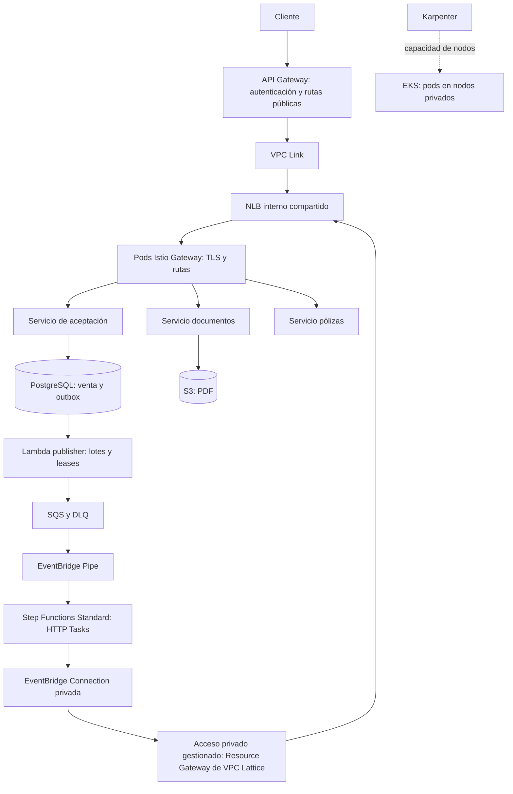

# Propuesta de arquitectura real de compras

Estado: diseño AWS para revisión. Laboratorio local actualizado el 2026-11-05:
API autenticada y HTTP Tasks pasan por NLB → Istio; compra/PDF validados.
Ver [evidencia local y límites](../localstack/VALIDATION.md).
Fecha de consulta de documentación/precios: 2026-11-05.

## Objetivo y supuestos

Prioridad del usuario: costo bajo; aceptación rápida; procesamiento asíncrono
puede tener mayor latencia. Step Functions debe llamar por HTTP a servicios detrás
de un NLB interno e Istio, sin Lambda de transporte. Se mantiene Lambda publisher.
Región de referencia: us-east-1. Exactamente dos AZ para subredes y workloads
administrados, según el requisito vigente.
Volumen, presupuesto mensual, RTO/RPO y duración máxima de pasos siguen pendientes.
No se afirma que esta propuesta sea el mínimo costo absoluto sin esas cifras.

## Recorrido

Todos los servicios pueden empezar como despliegues del código actual; separarlos
por dominio no exige introducir bases independientes en el primer laboratorio.
Las dependencias de datos y propiedad de escrituras se diseñan antes de dividirlas.

### Aceptación

POST autentica, valida y confirma una transacción corta venta+outbox. Devuelve 202
con saleId después del commit. No espera publisher, Step Functions ni PDF.
Índice único de idempotencia, pool de conexiones y límites de concurrencia.
Dos réplicas calientes de aceptación y gateway distribuidas entre AZ; no escalar
a cero ese recorrido. Aceptación rápida depende también de micro y DB, no solo
de API Gateway.

Para costo, candidato inicial: HTTP API con JWT authorizer nativo si identidad y
funcionalidades requeridas lo permiten. REST API actual no se migra sin revisar
requisitos de autenticación, protección y contratos. Integración privada por
VPC Link al listener NLB; configurar TLS, hostname y reescritura de rutas.
[Integraciones privadas API Gateway](https://docs.aws.amazon.com/apigateway/latest/developerguide/http-api-develop-integrations-private.html).

### Acceso de Step Functions

Recomendación: HTTP Task con EventBridge Connection privada vinculada a Resource
Configuration y Resource Gateway. AWS administra asociación de acceso. Se conserva
Istio como enrutador; no hace falta modelar cada micro como servicio L7 de Lattice.
[Conexiones privadas](https://docs.aws.amazon.com/eventbridge/latest/userguide/connection-private.html).

No son dos opciones intercambiables «Lattice o endpoint». Un interface endpoint
de Step Functions permite llamar a sus APIs desde VPC; no proporciona salida del
workflow hacia pods. Un endpoint PrivateLink arbitrario tampoco sustituye la
conexión soportada por HTTP Task.
[Endpoint de Step Functions](https://docs.aws.amazon.com/step-functions/latest/dg/vpc-endpoints.html).

HTTP Task exige HTTPS, Connection y, actualmente para APIs privadas, nombre de
dominio público con certificado de confianza pública. No soporta mTLS cliente;
límite de llamada: 60 segundos. Dominio público no significa NLB público.
Diseñar DNS del dominio propio, resolución del Resource Gateway y renovación del
certificado; no usar nombres .svc.cluster.local como endpoint de Step Functions.
[Contrato HTTP Task](https://docs.aws.amazon.com/step-functions/latest/dg/call-https-apis.html).

## NLB, Istio y nombres

NLB interno compartido: listener TCP 443, TLS termina en Istio Gateway. Target type
`ip`: targets son IPs de pods **gateway**, no todos los micros ni IPs fijas de nodos.
Requiere red de pods enrutable, propuesta AWS VPC CNI. AWS Load Balancer Controller
reconcilia targets cuando cambian pods.
[NLB en EKS](https://docs.aws.amazon.com/eks/latest/userguide/network-load-balancing.html).

Istio selecciona servicio por host/ruta y balancea sus endpoints. NLB no selecciona
micro por nombre HTTP y no comunica nodos entre sí.

Base económica: un dominio de entrada de workflow, por ejemplo
`workflow.example.com`, con rutas `/documentos/...` y `/polizas/...`. Reduce objetos
de DNS, certificados y configuraciones privadas. Si nombre por host es requisito,
usar `documentos.example.com`, `polizas.example.com` apuntando al mismo NLB, con
certificados/rutas/configuraciones de recurso correspondientes; no crear NLB por micro.
El nombre de servicio en ruta sigue siendo lógico, independiente del nodo/pod.

Dentro del mesh: gateway → sidecar del micro con mTLS STRICT y autorización por
identidad. Llamadas micro → micro usan descubrimiento Kubernetes/Istio, sin regresar
por NLB. TLS de entrada y mTLS interno son conexiones diferentes.
[TLS en Istio](https://istio.io/latest/docs/tasks/traffic-management/ingress/secure-ingress/).

Entrada pública y operaciones internas pueden compartir NLB, pero no permisos:
API Gateway expone solo rutas de cliente; token de usuario no autoriza operaciones
del workflow. Conexión usa credencial de servicio validada por gateway/aplicación
(OAuth2 si existe IdP apropiado; API key rotada como alternativa). Host/ruta por sí
solos no son autorización. Restricción de SG, NetworkPolicy e IAM por recurso.
Si exigencias de aislamiento lo requieren, separar gateways/listeners y evaluar
su costo antes de separar NLBs.

## Nodos y escalado

- Base pequeña On-Demand en Managed Node Group, dos nodos entre AZ, para controladores
  (Karpenter, Istiod, AWS LBC, DNS) y capacidad estable de aceptación/gateway.
  Evita que arranque del controlador dependa de nodos que él debe crear.
- Karpenter crea capacidad EC2 adicional mediante NodePools y EC2NodeClass. No
  administra tamaño del Managed Node Group existente.
- HPA escala réplicas; scheduler ubica pods; Karpenter aporta nodos cuando falta
  capacidad. No representa balanceo de tráfico.
- Workers asíncronos pueden usar Spot y varias familias/tamaños, con fallback
  On-Demand y límites de capacidad. No prometer ahorro porcentual sin carga medida.
- Requests incluyen sidecars. Aplicar topology spread, PDB, budgets de disrupción,
  drenaje Envoy y deregistration del target group coordinados con grace periods.
  PDB no evita caída involuntaria de nodo/AZ ni garantiza cero interrupciones.
- Conservar capacidad de gateway por AZ. Decidir cross-zone explícitamente:
  activarlo favorece distribución, pero puede sumar tráfico entre AZ; no desactivarlo
  solo por precio sin probar pérdida de targets.

[Base Karpenter](https://karpenter.sh/docs/getting-started/migrating-from-cas/),
[disrupciones](https://karpenter.sh/docs/concepts/disruption/).

## Workflow y confiabilidad

Standard como base: historial durable y recuperación revisable. Express se evalúa
con volumen/duración y semántica, no se cambia solo por tarifa aparente.
Normalización mediante Pass/Choice/intrínsecas; tareas de negocio mediante HTTP.
Pasos por frontera de negocio, no una transición por método interno Java.

Mantener publisher periódico en lotes es coherente con tolerancia a demora:
su intervalo actual de un minuto no afecta respuesta 202, sí finalización.
Outbox conserva leases y confirmación de publicación; entrega al menos una vez.

Cada operación HTTP idempotente por venta/generación/paso. Retry acotado con backoff
y jitter para errores recuperables; evitar reintentos multiplicados entre Istio y
workflow. Timeout HTTP puede ocurrir después de commit: reintento debe recuperar
resultado, no duplicar efecto. Mantener concurrencia limitada a capacidad DB/micros.
Pasos largos necesitan trabajo asíncrono y consulta de estado, o otro patrón explícito;
un 202 del micro no equivale a paso terminado. PDF viaja directamente a S3, solo
identificador/clave viaja en workflow. Fallo posterior de ejecución requiere recuperación
de negocio; no se atribuye automáticamente a DLQ SQS.

## Costo: decisiones y cálculo pendiente

### Control de admisión pendiente de decisión

Pipes SQS → Standard no ofrece un parámetro por pipe para fijar N arranques/s.
BatchSize y ventana de batching no son limitadores de tasa. FIRE_AND_FORGET
confirma inicio, no finalización del workflow: concurrencia del pipe no representa
ejecuciones de negocio activas. FIFO tampoco hace que espere su finalización.
[Parámetros SQS](https://docs.aws.amazon.com/eventbridge/latest/pipes-reference/API_PipeSourceSqsQueueParameters.html),
[destino Standard](https://docs.aws.amazon.com/eventbridge/latest/pipes-reference/API_PipeTargetStateMachineParameters.html).

Si límite estricto de arranques es requisito, variante propuesta para evaluar:
SQS → dispatcher en EKS → StartExecution, sustituyendo Pipe en ese tramo.
Dispatcher aplica límite global de tasa/burst (o ventana deslizante si se requiere
máximo en cualquier segundo) y opcionalmente máximo de workflows activos.
No es una Lambda ni es llamado por Step Functions. Añade código y operación;
no se presenta como configuración nativa de Pipes ni como opción ya aprobada.

Requiere permisos mínimos, coordinación durable entre réplicas/failover, nombre
determinista por eventId y entrada estable, reconciliación de arranques con respuesta
incierta y borrado SQS solo después de confirmar inicio o ejecución equivalente.
Para máximo de activos, reconciliar estados terminales y reservas huérfanas;
no liberar cupos solo por TTL si ejecución sigue viva. No ejecutar Pipe y dispatcher
como consumidores simultáneos de misma cola.
[Idempotencia StartExecution](https://docs.aws.amazon.com/step-functions/latest/apireference/API_StartExecution.html).

Mantener Pipe es opción más simple si basta desacoplar y aceptar su escalado
gestionado. En ambos casos, proteger micros/DB y medir tasa de admisión, workflows
activos, antigüedad SQS, 429 y reintentos. Límite de arranques no limita por sí solo
RPS por servicio: dependen de duración, paralelismo y reintentos de pasos.

Referencias USD, us-east-1, 730 horas/mes, sin impuestos ni créditos:

| Concepto | Referencia, no total de solución |
|---|---|
| EKS con versión en soporte estándar | 0,10 USD/h ≈ 73 USD/mes, sin nodos |
| NLB | 0,0225 USD/h ≈ 16,43 USD/mes + NLCU y transferencia aplicable |
| Standard | 0,000025 USD/transición; 100.000 compras × 10 transiciones ≈ 25 USD antes de free tier/reintentos |

[EKS](https://aws.amazon.com/eks/pricing/),
[NLB](https://aws.amazon.com/elasticloadbalancing/pricing/),
[Step Functions](https://aws.amazon.com/step-functions/pricing/).

EKS+NLB suman aproximadamente 89,43 USD/mes **solo de esos dos cargos base**.
Faltan EC2/EBS, RDS y backups, API, SQS/Pipe/publisher, acceso privado, DNS,
certificados, observabilidad y transferencia. No es presupuesto desplegable.
Para tráfico pequeño, infraestructura permanente puede dominar costo por compra.

Presupuestar acceso privado con tarifas aplicables de PrivateLink/VPC Lattice y
objetos realmente provisionados. No asumir que recurso Lattice cuesta lo mismo
que servicio L7, ni multiplicar ciegamente tarifa de endpoint manual por conexiones
gestionadas. No se afirma aquí precio cerrado para integración gestionada.
[PrivateLink](https://aws.amazon.com/privatelink/pricing/),
[Lattice](https://aws.amazon.com/vpc/lattice/pricing/).

Optimización propuesta: un NLB, entrada privada compartida, payloads pequeños,
publisher por lotes, pocas transiciones útiles, retención limitada de logs y
muestreo de trazas exitosas. Diseñar salida de nodos/pods comparando NAT y endpoints
necesarios para ECR/S3/STS/Secrets/Logs; ninguno debe agregarse sin inventario de
dependencias y cálculo. Dos AZ ahorran algunas réplicas/endpoints frente a tres,
pero reducen margen ante fallos; no hacen NLB/EKS control plane 1/3 más baratos.
DB Multi-AZ para producción si se requiere continuidad; Single-AZ solo aceptando
RTO mayor. RTO/RPO siguen sin definir.

## Observabilidad y criterio de validación

Trace context desde aceptación, persistido en outbox, transportado en evento y
propagado a HTTP Tasks/micros. Span links para reentregas/reprocesos cuando corresponda.
Correlacionar saleId/eventId/executionArn; no exportar tokens, PII ni PDFs.
OpenTelemetry Collector recibe trazas reales. Aspire sirve en laboratorio;
historial SFN sigue como evidencia de orquestación, separado de spans reconstruidos.

Antes de implementar: cerrar nombres por ruta/host, identidad de servicio, DNS/TLS,
RTO/RPO y rango de tráfico. Después probar:

1. Dos servicios detrás de mismo NLB: cada ruta llega solo al servicio previsto.
2. Historial de workflow sin invocaciones Lambda; HTTP Tasks ejecutados realmente.
3. Bloqueo de acceso interno con identidad de usuario y acceso directo no autorizado.
4. Retiro/reemplazo de nodo Karpenter, drenaje y recuperación sin efectos duplicados.
5. Fallos transitorios/permanentes, timeout después de commit y reentrega SQS.
6. TLS de entrada, mTLS interno, límites de concurrencia y estado/PDF persistentes.
7. p95/p99 de aceptación separado de espera de cola y tiempo de procesamiento.

LocalStack puede validar contratos y partes del recorrido, pero no prueba latencia,
precio, red gestionada AWS ni comportamiento EC2/Karpenter real. Si carece de HTTP
Task privado, NLB o Lattice funcionales, esa prueba queda pendiente; no se sustituye
silenciosamente con Lambda transport. Actualmente no se autoriza usar AWS real.

Topología local desplegada conserva NLB y usa HTTP Tasks por red Docker.
Conectividad privada gestionada AWS, TLS e IAM requieren validación aparte;
no se declara paridad por haber aprobado flujo funcional local.
