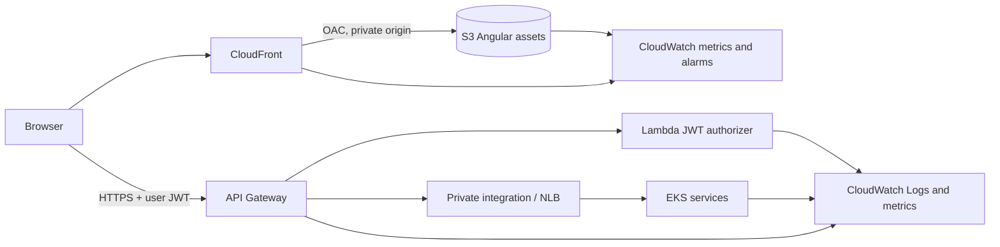

# Angular frontend, API authorizer and CloudWatch

## LocalStack deployment

From WSL at the repository root, with the local lab running and Node.js 20.19+
or 22.12+ installed:

```bash
npm --prefix frontend ci
localstack/.venv/bin/python localstack/frontend/frontend.py deploy \
  --endpoint http://127.0.0.1:4566
localstack/.venv/bin/python localstack/frontend/frontend.py status \
  --endpoint http://127.0.0.1:4566
```

The deployment builds Angular with `/micro-test-local-frontend/` as its base path,
creates the `micro-test-local-frontend` bucket, and uploads the static assets. The
reported URL uses the LocalStack path-style endpoint so the UI and API Gateway
share the `127.0.0.1:4566` origin. The bucket policy allows public reads only
inside this loopback-bound emulator. Do not copy that policy to AWS.

The deployment checks that the existing `purchase-jwt` TOKEN authorizer points to
`micro-test-local-authorizer` and protects POST `/purchases`, GET
`/purchases/{saleId}`, and POST `/purchases/{saleId}/retry`. The business
CloudFormation stack owns that Lambda and its API Gateway invoke permission; the
frontend stack does not create another authorizer or expose the signing secret.

The browser needs the short-lived `@baseUrl` and `@token` from the generated
`localstack/.state/business/purchase.http`. Keep the signing key out of Angular,
the object bucket, and application logs. If accessing the laptop from another
computer, use SSH local port forwarding rather than publishing port 4566 on the
LAN:

```bash
ssh -N -L 4567:127.0.0.1:4566 josue@192.168.1.16
```

Then open `http://127.0.0.1:4567/micro-test-local-frontend/index.html` on that
computer. Choose another unused local port if 4567 is occupied. The frontend
uses the page's same-origin tunnel for API calls. Keep the SSH session open while
testing. LocalStack's other APIs are also reachable through this authenticated
tunnel, so close it when finished.

## AWS target architecture



AWS must use a private S3 bucket and CloudFront Origin Access Control, not the
public-read LocalStack policy. The browser calls API Gateway independently of
CloudFront. Configure CORS to allow only the approved CloudFront origin. The
Lambda authorizer validates the user JWT; its signing material remains in
Secrets Manager/Lambda and never ships to the browser. API Gateway forwards only
the identity data required by the microservice. Choose API Gateway stage log
fields that do not record `Authorization`, request bodies, secrets, or PII.

## CloudWatch inventory to implement for AWS

| Component | Logs / metrics to add | Suggested operational signals |
|---|---|---|
| CloudFront | Distribution request, error, and latency metrics; access logs only when justified | 4xx/5xx rate and origin failures |
| S3 frontend | Request metrics and server access logging only when needed | 4xx/5xx and origin access failures |
| API Gateway | Redacted JSON access logs with request ID, route, status, latency; 4XX/5XX, latency, throttling metrics | 5XX, throttling, latency |
| Lambda authorizer | Lambda log group, duration, errors, throttles; never log JWT or signing key | Authorizer errors, throttles, duration |
| Lambda publisher | Structured operational logs, duration, errors, throttles | Publish failures and outbox lag |
| EKS microservices | Container logs, metrics and traces correlated by `saleId`, `eventId`, and workflow execution ID | API errors, latency, pod health |
| SQS / Pipe / Step Functions | Queue depth/age, DLQ count, Pipe errors, workflow executions, failures and duration | DLQ growth, oldest-message age, failed workflows |

Set log retention, encryption, metric filters and alarm thresholds as explicit
deployment decisions. Ensure log content is redacted before export. Aspire in the
LocalStack lab reconstructs selected Step Functions history; it is not AWS
CloudWatch and does not provide native S3/API Gateway metrics.

CloudFront, private S3/OAC, AWS CloudWatch log groups, dashboards and alarms are
architecture requirements only. This repository still has no approved, executable
AWS deployment template, and none of these AWS resources has been created.
