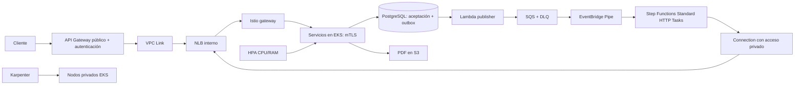

# AWS / CloudFormation — implementación pendiente

**Todavía no existe un despliegue AWS reproducible en este repositorio.**
Esta es la única entrada para esa próxima etapa, después de validar laboratorio
[LocalStack](../localstack/README.md). No ejecutar plantillas locales en AWS real.
Plantillas anteriores fueron retiradas porque representaban diseños distintos;
su historial permanece en Git, no son una base de despliegue aprobada.

## Arquitectura que se implementará

API Gateway atiende aceptación/consulta/retry públicos. Step Functions evita API
Gateway y Lambda de transporte; accede al NLB por conectividad privada compatible
con HTTP Tasks. NLB balancea conexiones, Istio decide servicio por host/ruta.
VPC, subredes privadas, grupos de seguridad, identidades IAM, TLS de entrada,
mTLS, secretos, logs y persistencia deben diseñarse como conjunto.

[Diseño y decisiones de costo](ARCHITECTURE.md) conserva fundamentos y alternativas.
No es promesa de precio, paridad LocalStack ni autorización para desplegar.

## Antes de generar plantillas

Cerrar con usuario: cuenta/región, dos o tres AZ, presupuesto, volumen/SLO,
RTO/RPO, dominio y certificado, proveedor de identidad, conectividad privada de
HTTP Tasks, endpoints/egreso, tamaño de DB y distribución de workloads Karpenter.
Mantener Pipes por ahora: no ofrece limitador configurable de ejecuciones por
segundo; HPA/Karpenter tampoco controlan tasa de admisión.

La implementación deberá versionar:

1. CloudFormation: VPC/subredes/rutas/endpoints/SG; EKS/IAM/ECR; RDS/secretos;
   S3; NLB y conectividad privada; SQS/DLQ/Pipe/SFN; publisher/Scheduler; API.
2. Helm/manifiestos: Istio y mTLS, políticas, controladores, HPA, Karpenter,
   NodePools/NodeClasses, rutas, despliegues y distribución entre nodos/AZ.
3. Código/artefactos: Lambda, ASL HTTP, imágenes por digest, migraciones SQL,
   configuración sin secretos y comandos de bootstrap verificables.
4. Pruebas: identidad y permisos efectivos, aislamiento, routing, compra/PDF,
   idempotencia, fallos/reintentos, nodos reales, HPA, drenaje, recuperación,
   persistencia, observabilidad, costo y latencia medidos.

CloudFormation no sustituye bootstrap Kubernetes, build de imágenes ni migraciones.
Nombres/IP/puertos Docker, token JWT ficticio y credenciales `test/test` del lab
no deben trasladarse a AWS.

## Criterio para comenzar

Primero ejecutar arranque local desde cero y pruebas obligatorias; guardar reporte
sin secretos. Resolver resultados pendientes de HPA/Karpenter/persistencia. Después
aprobar decisiones anteriores y generar infraestructura real. Ningún comando de
este README crea recursos ni consulta cuentas AWS.
