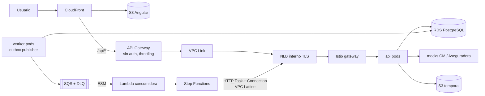

# AWS — laboratorio micro-test

Entrada única de la implementación AWS (`us-east-1`). Estado: plantillas, app, pruebas y
bootstrap escritos y validados offline; **despliegue en AWS pendiente**. Decisiones y avance:
[PLAN_AWS.md](PLAN_AWS.md). El laboratorio [LocalStack](../localstack/README.md) es
independiente: sus plantillas no se despliegan en AWS.

## Arquitectura vigente

**Una sola Lambda en AWS: la consumidora** (`micro-test-consumer`, en
`04-messaging.yaml`). No hay authorizer (API sin autenticación, N09) ni Lambda publisher
(lo reemplaza el worker Spring, N06). Las Lambdas `micro-test-local-publisher` y
`micro-test-local-authorizer` pertenecen solo al laboratorio LocalStack.

## Documentos

| Necesito… | Documento |
|---|---|
| Desplegar stack por stack (orden, comandos, costos, eliminación) | [cloudformation/README.md](cloudformation/README.md) |
| Mover el DNS de `mercally.dev` (Hostinger) a Route 53; lab en `aws.mercally.dev` | [DNS.md](DNS.md) |
| Instalar Istio, LBC, KEDA, Karpenter y la app; operar el laboratorio | [kubernetes/README.md](kubernetes/README.md) |
| Ver componentes, fronteras de seguridad y requisitos IaC | [diagrams/ARQUITECTURA-C4.md](diagrams/ARQUITECTURA-C4.md) |
| Entender el flujo asíncrono y los reintentos | [diagrams/SECUENCIA-ASYNC.md](diagrams/SECUENCIA-ASYNC.md) |
| Configurar y sincronizar Lambda, KEDA, HPA y Karpenter | [diagrams/ESCALADO.md](diagrams/ESCALADO.md) |
| Lanzar carga (N ventas, misma venta, paralelo) y observar por CLI | [CARGA.md](CARGA.md) + [load.sh](load.sh) |
| Saber qué ver en CloudWatch | [diagrams/OBSERVABILIDAD.md](diagrams/OBSERVABILIDAD.md) |
| Revisar change sets y validación genérica | [CLOUDFORMATION.md](CLOUDFORMATION.md) |
| Fundamentos y alternativas del diseño original | [ARCHITECTURE.md](ARCHITECTURE.md) (histórico) |

Nada de este directorio crea recursos por sí solo: cada `deploy` o `bootstrap.sh` lo ejecuta
el usuario.
