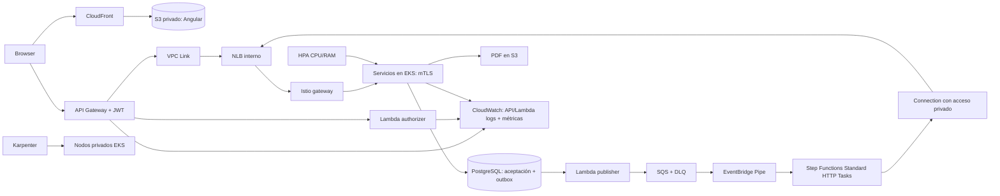

# AWS / CloudFormation — implementación pendiente

**Todavía no existe un despliegue AWS reproducible en este repositorio.**
Esta es la única entrada para esa próxima etapa, después de validar laboratorio
[LocalStack](../localstack/README.md). No ejecutar plantillas locales en AWS real.
Plantillas anteriores fueron retiradas porque representaban diseños distintos;
su historial permanece en Git, no son una base de despliegue aprobada.

**Seguimiento:** [plan AWS, respuestas y prompt base](PLAN_AWS.md).
Este documento se completará con las decisiones del usuario, las plantillas
creadas, sus dependencias y la evidencia de cada etapa.

## Validar sin crear recursos y ejecutar por etapas

Ver [guía CloudFormation: validación, orden y ejecución manual](CLOUDFORMATION.md).
Incluye validación offline de las diez plantillas locales actuales, diferencias
entre `validate-template` y change sets, y procedimiento AWS por stack.
El orden AWS es propuesto: faltan los YAML reales y sus parámetros definitivos.
La validación local no convierte las plantillas LocalStack en plantillas AWS.

## Arquitectura que se implementará

CloudFront entrega la SPA desde S3 privado con OAC; el navegador llama a API
Gateway de forma independiente. La Lambda authorizer valida JWT; API Gateway
envía al microservicio el token y el sujeto verificado. Configurar CORS solo para
los orígenes CloudFront aprobados, sin exponer claves de firma al navegador.
API Gateway atiende aceptación/consulta/retry públicos. Step Functions evita API
Gateway y Lambda de transporte; accede al NLB por conectividad privada compatible
con HTTP Tasks. NLB balancea conexiones, Istio decide servicio por host/ruta.
VPC, subredes privadas, grupos de seguridad, identidades IAM, TLS de entrada,
mTLS, secretos, logs y persistencia deben diseñarse como conjunto.

### Frontend, identidad y CloudWatch

En LocalStack, `./localstack/lab frontend` publica Angular en el bucket
`micro-test-local-frontend`. La ruta de objeto path-style mantiene la UI en el
mismo origen `127.0.0.1:4566` que el API emulado. El stack de negocio ya crea
`micro-test-local-authorizer`, su permiso para API Gateway, el authorizer
`purchase-jwt` y rutas POST/GET protegidas. `frontend-status` comprueba esa
relación antes de dar la UI por lista. La lectura pública del bucket es exclusiva
de LocalStack, que se publica en loopback; no debe trasladarse a AWS.

Para AWS, la arquitectura objetivo es CloudFront → bucket S3 privado con OAC y
CloudFront → API Gateway. El JWT de usuario llega al API; la Lambda authorizer
lo valida con un secreto gestionado en Secrets Manager y solo después se enruta
la solicitud autenticada. Se requiere CORS restringido a los dominios CloudFront
aprobados. Ningún token de firma debe estar en assets estáticos, logs o
configuración del navegador.

Al generar la observabilidad AWS, representar como fuentes separadas y
correlacionables:

| Componente | Evidencia/logs AWS previstos |
|---|---|
| CloudFront + S3 Angular | CloudFront: requests/errores/latencia; S3: métricas de solicitudes y latencia si se habilitan; access logs según necesidad |
| API Gateway | Access logs JSON del stage (request ID, ruta, status, latencia y sujeto seudonimizado si está aprobado); métricas 4XX/5XX/latencia |
| Lambda authorizer | `/aws/lambda/micro-test-authorizer`, duración, errores y throttles; nunca registrar JWT ni secreto |
| Lambda publisher | `/aws/lambda/micro-test-publisher`, publicación de outbox, errores y duración |
| Microservicios/EKS | Logs centralizados, métricas y trazas con `saleId`/`eventId`; no exportar PII, tokens ni URLs firmadas |
| SQS/Pipe/Step Functions | Edad/profundidad de cola, DLQ, fallos de Pipe, ejecuciones/reintentos y duración del workflow |

Añadir retención explícita y alarmas para 5XX, throttling, errores del authorizer,
crecimiento de DLQ y retraso SQS. La redacción de logs y los permisos CloudWatch
deben probarse antes de habilitar tráfico. Estos recursos/configuraciones AWS aún
no están desplegados ni representados por las pruebas locales. En LocalStack,
los grupos de log de authorizer/publisher pertenecen al stack de negocio; Aspire
es una proyección local del historial Step Functions, no CloudWatch ni una fuente
de métricas nativa de S3/API Gateway.

[Diseño y decisiones de costo](ARCHITECTURE.md) conserva fundamentos y alternativas.
No es promesa de precio, paridad LocalStack ni autorización para desplegar.

## Antes de generar plantillas

Decidido: exactamente dos AZ para subredes y workloads administrados.
Cerrar con usuario: cuenta/región, presupuesto, volumen/SLO,
RTO/RPO, dominio y certificado, proveedor de identidad, conectividad privada de
HTTP Tasks, endpoints/egreso, tamaño de DB y distribución de workloads Karpenter.
Mantener Pipes por ahora: no ofrece limitador configurable de ejecuciones por
segundo; HPA/Karpenter tampoco controlan tasa de admisión.

La implementación deberá versionar:

1. CloudFormation: VPC/subredes/rutas/endpoints/SG; EKS/IAM/ECR; RDS/secretos;
   S3; NLB y conectividad privada; SQS/DLQ/Pipe/SFN; publisher/Scheduler; API.
2. Helm/manifiestos: Istio y mTLS, políticas, controladores, HPA, Karpenter,
   NodePools/NodeClasses, rutas, despliegues y distribución entre nodos/AZ.
3. Código/artefactos: Lambda, ASL HTTP, imágenes por digest, migraciones SQL,
   configuración sin secretos y comandos de bootstrap verificables.
4. Pruebas: identidad y permisos efectivos, aislamiento, routing, compra/PDF,
   idempotencia, fallos/reintentos, nodos reales, HPA, drenaje, recuperación,
   persistencia, observabilidad, costo y latencia medidos.

CloudFormation no sustituye bootstrap Kubernetes, build de imágenes ni migraciones.
Nombres/IP/puertos Docker, token JWT ficticio y credenciales `test/test` del lab
no deben trasladarse a AWS.

## Criterio para comenzar

Primero ejecutar arranque local desde cero y pruebas obligatorias; guardar reporte
sin secretos. Resolver resultados pendientes de HPA/Karpenter/persistencia. Después
aprobar decisiones anteriores y generar infraestructura real. Ningún comando de
este README crea recursos ni consulta cuentas AWS.
