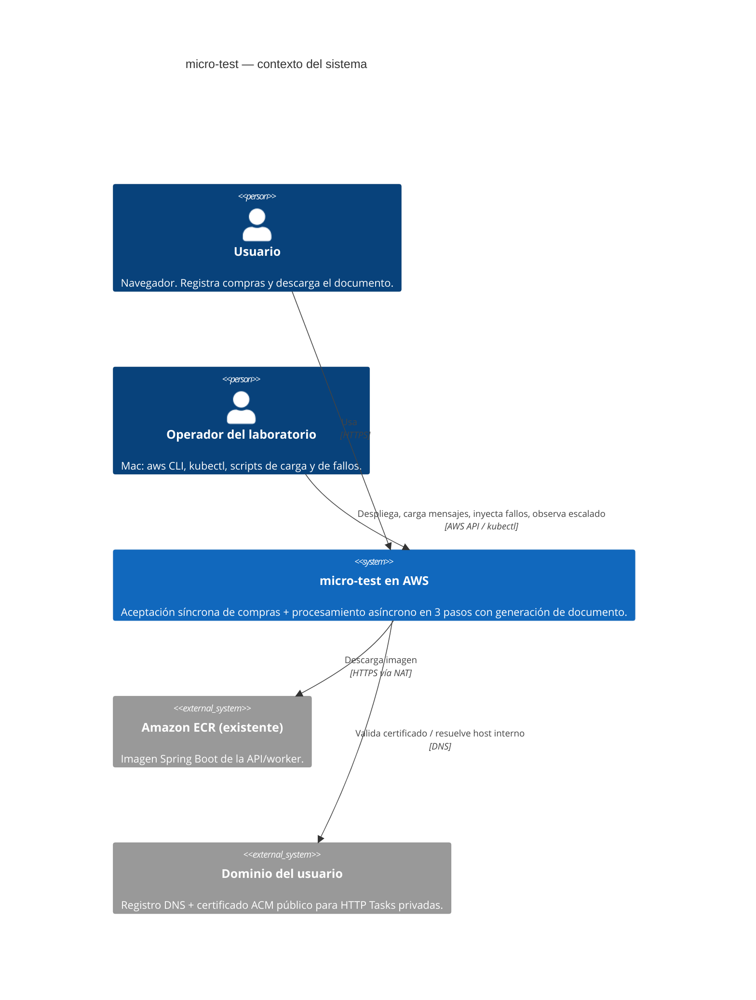
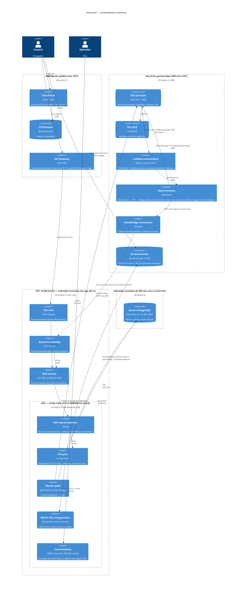
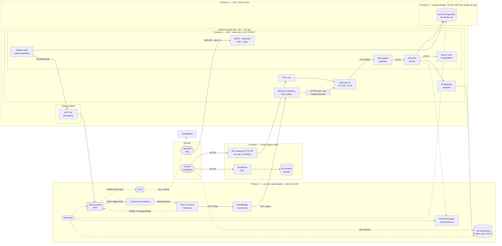

# Arquitectura AWS — modelo C4 y fronteras de seguridad

Estado: diseño del laboratorio semi-productivo, región `us-east-1`. Decisiones en
[PLAN_AWS.md](../PLAN_AWS.md) (N01–N12). Recursos con stack asignado: ver tabla final.
Secuencia del procesamiento asíncrono: [SECUENCIA-ASYNC.md](SECUENCIA-ASYNC.md).

## Nivel 1 — Contexto



## Nivel 2 — Contenedores con fronteras



> Mermaid C4 es experimental: si el layout se ve apretado, la vista de fronteras
> siguiente muestra la misma información con mejor legibilidad.

## Vista de fronteras de seguridad



## Fronteras y controles

| Frontera | Qué la cruza | Control |
|---|---|---|
| 1. Internet → borde AWS | Navegador → CloudFront / API Gateway | HTTPS; bucket frontend solo por OAC; API **sin auth** (N09) mitigada con throttling; `/internal/*` nunca publicado |
| 2. Servicios gestionados | SQS ↔ Lambda ↔ SFN ↔ S3 | Rol IAM por componente, mínimo privilegio; cifrado KMS en reposo |
| 3. Entrada a la VPC | API Gateway (VPC Link) y SFN (Resource Gateway) → NLB | NLB interno sin IP pública; SG NLB solo admite 443 desde VPC Link y Resource Gateway; SG app solo admite 8080/15021 desde el NLB; TLS termina en el NLB (ACM) |
| 4. Malla Istio | Gateway → API, pod → pod | mTLS STRICT (CA istiod); AuthorizationPolicy: `/internal/*` solo con credencial del workflow (D07 pendiente) |
| 5. Datos | Pods → Aurora | Subred sin ruta a Internet; SG db solo desde SG app; secreto gestionado; KMS |
| Egreso | Pods → ECR, SQS, AWS APIs | NAT único (sin tolerancia a caída de AZ A, N08); S3 por gateway endpoint gratuito |
| Operación | Mac → EKS API, AWS APIs | Endpoint EKS público restringido por CIDR/IAM (D11 pendiente); Data API de Aurora para SQL |

## Piezas de integración

Dos tramos del flujo dependen de piezas que no se ven como "componentes" en el
diagrama, pero que la IaC debe crear explícitamente:

```text
SQS ──[ESM]──▶ Lambda ──▶ Step Functions ──[HTTP Task + Connection]──▶ Resource Gateway ──▶ NLB ──▶ Istio ──▶ API
     tramo 1                                      tramo 2
```

### Tramo 1 — Event Source Mapping (SQS → Lambda)

SQS no empuja mensajes y Lambda no escucha por sí sola. El ESM es el poller
gestionado por Lambda (el "trigger SQS" de la consola): recibe el mensaje (que
queda invisible), invoca la Lambda y, si la Lambda responde éxito, lo borra.

| Configuración | Valor | Motivo |
|---|---|---|
| `FunctionResponseTypes` | `ReportBatchItemFailures` | La Lambda reporta el mensaje como fallido para que el ESM **no** lo borre: el lease lo cierra Step Functions (N02) |
| `BatchSize` | 1 | Una ejecución por mensaje; un fallo no arrastra a otros |
| `ScalingConfig.MaximumConcurrency` | 2 (parámetro) | Control de admisión hacia Step Functions; perilla de pruebas de carga |
| `Enabled` | parámetro `ConsumerEnabled` | Pausar consumo sin borrar nada: la cola acumula |
| Permisos del rol Lambda | `sqs:ReceiveMessage/DeleteMessage/GetQueueAttributes/ChangeMessageVisibility`, `kms:Decrypt` | El ESM usa el rol de la Lambda; la cola está cifrada con KMS |

Sin costo propio (se pagan invocaciones Lambda y requests SQS). Alternativa
descartada: Lambda programada que lea la cola (más código, sin control de concurrencia).

### Tramo 2 — EventBridge Connection (Step Functions → API privada)

La HTTP Task (`arn:aws:states:::http:invoke`) **exige** un `ConnectionArn`. La
Connection aporta:

1. **Credencial del workflow** (`X-Workflow-Key`), guardada por EventBridge en
   Secrets Manager; nunca aparece en el ASL ni en logs. Permite a la API distinguir
   llamadas del workflow de las de usuario (enforcement pendiente, D07).
2. **Ruta privada**: `ResourceParameters.ResourceConfigurationArn` apunta a una
   Resource Configuration de VPC Lattice asociada a un Resource Gateway en las
   subredes de app. Step Functions corre fuera de la VPC; sin esto no alcanza el NLB interno.

| Requisito | Dónde se crea |
|---|---|
| Connection (API key + `ResourceConfigurationArn`) | `04-messaging.yaml` |
| Rol SFN: `states:InvokeHTTPEndpoint` (limitado a `${ApiBaseUrl}/api/v1/internal/purchases/*`), `events:RetrieveConnectionCredentials`, `secretsmanager:GetSecretValue` del secreto de la Connection | `04-messaging.yaml` |
| Resource Gateway + Resource Configuration hacia el NLB | 06 ingress |
| Listener TLS 443 del NLB con certificado ACM público del host interno | 06 ingress |
| Registro DNS del host interno y registro de validación ACM | 06 ingress / proveedor DNS |
| Validación de `X-Workflow-Key` en Istio o API para `/internal/*` | Manifiestos / app (D07) |

Costo: la Connection no tiene cargo; su secreto ~$0.40/mes; el Resource Gateway
cobra por hora y GB (estimar en 06). Alternativas descartadas: Lambda de transporte
por paso (invocación extra, descartada en el plan original) y API Gateway delante de
`/internal/*` (expondría rutas internas, contradice N09).

## Dominio y certificado

| Pregunta | Respuesta |
|---|---|
| ¿Para qué el dominio? | La HTTP Task solo llama HTTPS con **certificado de confianza pública**; una CA pública (ACM, gratis) solo lo emite para un nombre que demuestres controlar. El nombre del NLB (`*.elb.amazonaws.com`) no es tuyo |
| ¿Hace pública la API? | No. El nombre (p. ej. `api-internal.<dominio>`) y el registro de validación ACM existen en DNS, pero el tráfico solo llega por VPC Lattice → NLB interno. No hay ruta desde Internet |
| ¿Quién más lo necesita? | Nadie obligatoriamente. CloudFront (`*.cloudfront.net`) y API Gateway (`*.execute-api.amazonaws.com`) usan dominios y certificados de AWS. Dominio propio para usuarios: opcional, posterior |
| ¿Costo? | Certificado ACM público: $0. Zona en Route 53: ~$0.50/mes si se usa; si el DNS está en otro proveedor, solo se agregan registros allí |
| Por verificar en 06 | Tipo de Resource Configuration (DNS/ARN) y resolución del nombre propio vía VPC Lattice, según documentación oficial vigente |

## Requisitos IaC por componente

| Componente | Debe crear / configurar | Stack |
|---|---|---|
| VPC | Subredes en 2 AZ, tags `kubernetes.io/role/internal-elb` y `karpenter.sh/discovery`, NAT único, S3 gateway endpoint, SG app/db | 01 |
| KMS | Llave única con rotación; acceso delegado a IAM | 02 |
| Aurora | Serverless v2 0–4 ACU, auto-pausa, secreto gestionado, Data API, snapshot al borrar | 03 |
| S3 temporal | Privado, SSE-KMS, solo HTTPS, lifecycle | 03 |
| SQS + DLQ | KMS, visibility 360 s > timeout SFN 300 s, `maxReceiveCount` 3 | 04 |
| ESM | Ver tramo 1 | 04 |
| Lambda consumidora | Fuera de VPC, nombre de ejecución `messageId-receiveCount`, siempre `batchItemFailures` | 04 |
| Step Functions | Standard, ASL embebido, 3 intentos/paso, `DeleteMessage` → cleanup, `changeMessageVisibility` en fallo, logs ERROR | 04 |
| Connection | Ver tramo 2 | 04 + 06 |
| Alarma DLQ | Alarma + regla EventBridge → log group (SNS después) | 04 |
| EKS | Control plane, node group base AZ A, Pod Identity (API: S3; worker: `sqs:SendMessage` + `kms:GenerateDataKey/Decrypt`), IAM Karpenter/KEDA/LBC | 05 |
| NLB | Interno, listener TLS 443 con ACM, target group IP + `TargetGroupBinding` hacia Istio gateway | 06 |
| API Gateway | HTTP API, VPC Link al NLB, solo rutas públicas, throttling de stage | 06 |
| Resource Gateway | VPC Lattice en subredes app, Resource Configuration → NLB | 06 |
| Frontend | S3 privado + CloudFront OAC | 07 |
| Kubernetes (no CFN) | Istio mTLS STRICT, AuthorizationPolicy `/internal/*`, KEDA ScaledObject, Karpenter NodePool, Deployments API/worker/mocks | `aws/kubernetes/` |

## Componentes y stack

| Componente | Stack | Estado |
|---|---|---|
| VPC, subredes, NAT, SG, S3 endpoint | `01-network.yaml` | Lint OK |
| KMS | `02-security.yaml` | Lint OK |
| Aurora, secreto, S3 documentos | `03-data.yaml` | Lint OK |
| SQS, DLQ + alarma, Lambda, Step Functions, Connection | `04-messaging.yaml` | Lint OK |
| EKS, node group base, add-ons, Pod Identity, IAM y cola Karpenter | `05-eks.yaml` | Lint OK |
| Certificado ACM, DNS, NLB, VPC Link, API Gateway, Resource Gateway | `06-ingress.yaml` | Lint OK |
| S3 frontend, CloudFront (+ `/api/*` → API Gateway) | `07-frontend.yaml` | Lint OK |
| Istio, KEDA, Karpenter, LBC, Deployments | `aws/kubernetes/bootstrap.sh` (no CFN) | Render offline OK |
