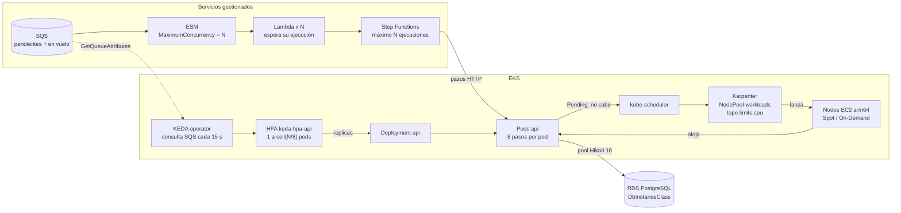
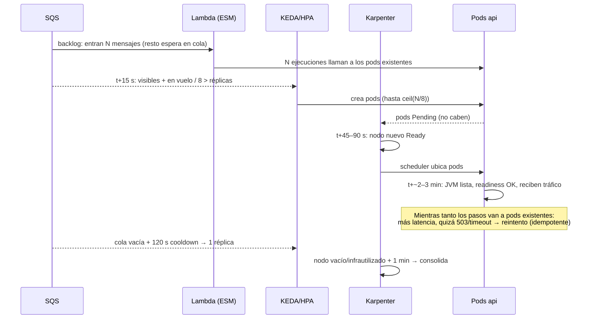

# Escalado: Lambda, KEDA, HPA y Karpenter

Cómo se controla la capacidad del laboratorio, dónde se configura cada pieza y qué reglas
las mantienen sincronizadas. Arquitectura general: [ARQUITECTURA-C4.md](ARQUITECTURA-C4.md).
Operación (comandos, perillas, carga): [aws/kubernetes/README.md](../kubernetes/README.md).

## Idea central: una sola perilla de admisión

```text
Mensajes en SQS ──▶ ESM MaximumConcurrency = N ──▶ N Lambdas ocupadas = N ejecuciones activas
                                                                   = N pasos HTTP simultáneos en la API
       KEDA dimensiona la API para N  ──▶  Karpenter dimensiona nodos para esos pods
```

La Lambda **espera** a que termine su ejecución (N02 rev.). Por eso `MaxConcurrency` es el
número real de ejecuciones simultáneas; todo lo demás se deriva de N. Sin esa espera, la Lambda
terminaría en milisegundos y el ESM arrancaría ejecuciones sin límite contra la API.

## Lazos de control



| Lazo | Señal | Decide | Acción | Retardo típico |
|---|---|---|---|---|
| Admisión | Mensajes disponibles | ESM | Hasta N Lambdas → N ejecuciones | Segundos |
| Pods | Mensajes visibles + en vuelo / 8 | KEDA → HPA | Réplicas de `api` entre 1 y ceil(N/8) | 15 s sondeo + ~30–40 s arranque JVM |
| Nodos | Pods `Pending` por falta de CPU/memoria | Karpenter | Lanza el nodo más barato que cabe; consolida al sobrar | ~45–90 s por nodo |
| Datos | Carga SQL | RDS PostgreSQL | No escala solo: cambiar `DbInstanceClass` (reinicio ~5 min) | Manual |

**HPA:** no se escribe a mano. KEDA crea `keda-hpa-api` desde el `ScaledObject`; el HPA
ejecuta el escalado con la métrica externa que KEDA le publica. Inspección:
`kubectl -n micro get hpa keda-hpa-api` y `kubectl -n micro describe scaledobject api`.

## Dónde se configura cada pieza

| Pieza | Controla | Archivo / recurso | Perilla |
|---|---|---|---|
| ESM (trigger SQS) | Ejecuciones simultáneas (N) | `04-messaging.yaml` · `ConsumerMapping` | `MaxConcurrency`, `ConsumerEnabled` |
| Lambda consumidora | Ocupada mientras dura su ejecución | `04-messaging.yaml` · `Consumer` | `Timeout` 330 s (fijo) |
| KEDA operator | Lectura de SQS, publicar métrica | Helm en `bootstrap.sh`; IAM `KedaRole` en `05-eks.yaml` | `KEDA_VERSION` |
| ScaledObject `api` | Réplicas de api | `aws/kubernetes/app.yaml` | `API_MESSAGES_PER_POD` (8); `API_MAX_REPLICAS` = ceil(N/8), **derivado** de `MaxConcurrency` |
| HPA | Aplica las réplicas | Lo crea KEDA | — |
| Requests de pods | Cuántos pods caben por nodo | `app.yaml` `resources` (100m / 384Mi + sidecar 50m / 64Mi) | Editar y re-ejecutar bootstrap |
| Karpenter controller | IAM, interrupciones Spot | `05-eks.yaml` (rol, cola, reglas) + Helm en `bootstrap.sh` | `KARPENTER_VERSION` |
| NodePool `workloads` | Tipos, Spot/On-Demand, tope, consolidación | `aws/kubernetes/platform.yaml` | `KARPENTER_CPU_LIMIT` (16), familias, tamaños |
| EC2NodeClass `workloads` | Subred AZ A, SG, AMI, disco | `aws/kubernetes/platform.yaml` | — |
| Nodos base | Controladores y sistema | `05-eks.yaml` `BaseNodeGroup` | `NodeCount`, `NodeInstanceType` |
| RDS PostgreSQL | Techo de capacidad de BD | `03-data.yaml` | `DbInstanceClass` (db.t4g.micro) |
| Pool JDBC | Conexiones por pod | `application.yml` Hikari | `maximum-pool-size` (10) |
| Entrada pública | Compras por segundo | `06-ingress.yaml` | `ThrottlingRateLimit`, `ThrottlingBurstLimit` |

## Reglas de sincronización

| # | Regla | Si no se cumple |
|---|---|---|
| 1 | Admisión única: solo `MaxConcurrency` decide cuántas ejecuciones entran | Ejecuciones sin límite saturan la API (corregido: la Lambda espera) |
| 2 | `API_MAX_REPLICAS` = ceil(N / `API_MESSAGES_PER_POD`) — el bootstrap lo calcula | Con mucha cola, KEDA crea pods que nadie usa y Karpenter paga nodos ociosos |
| 3 | `API_MESSAGES_PER_POD` ≤ pool Hikari (10) | Pasos esperando conexión → timeouts de 20 s → reintentos |
| 4 | `KARPENTER_CPU_LIMIT` ≥ CPU solicitada por todos los pods de app + daemonsets por nodo | Pods `Pending` con "limits exceeded": es el techo del laboratorio, a propósito |
| 5 | (api máx + worker + mocks) × 10 conexiones ≤ `max_connections` de RDS (~80 en db.t4g.micro) | Errores de conexión bajo carga (`SHOW max_connections` desde un pod) |
| 6 | Timeouts encadenados: paso HTTP 20 s · SFN 300 s < Lambda 330 s < visibility 360 s | Ejecuciones duplicadas o mensajes que reaparecen a mitad de proceso |
| 7 | Sin reintentos en Istio (`retries.attempts: 0`) | Reintentos multiplicados: Istio × paso × entrega |

Ejemplo de dimensionamiento: N = 40 → api máx = 5 pods → 5 × 150m + worker y mocks 300m
≈ 1.05 vCPU de requests → un nodo `t4g.large` basta; `limits.cpu` 16 deja margen para subir N.

## Línea de tiempo de una subida de carga



Para que la subida no produzca reintentos: subir `MaxConcurrency` en escalones (el
laboratorio) o elevar `minReplicaCount` antes de una prueba.

## Síntomas y perilla

| Síntoma (dashboard `micro-test-lab`) | Causa probable | Perilla |
|---|---|---|
| Cola crece, Lambda activas = N, API sin errores | Admisión es el cuello de botella | Subir `MaxConcurrency` |
| Latencia p99 / faults de api suben, pods al máximo | Pods saturados | Bajar `API_MESSAGES_PER_POD` o subir requests |
| Pods `Pending`, nodos no crecen | Tope de Karpenter alcanzado | `KARPENTER_CPU_LIMIT` |
| CPU de RDS al 100 % o conexiones al tope, latencia SQL alta | Techo de base de datos | `DbInstanceClass` (03) |
| Reintentos y DLQ en ráfagas al subir carga | Arranque de pods/nodos más lento que la rampa | Escalones más suaves o `minReplicaCount` |
| 429 en API pública | Throttling de entrada (esperado) | `ThrottlingRateLimit` (06) |
