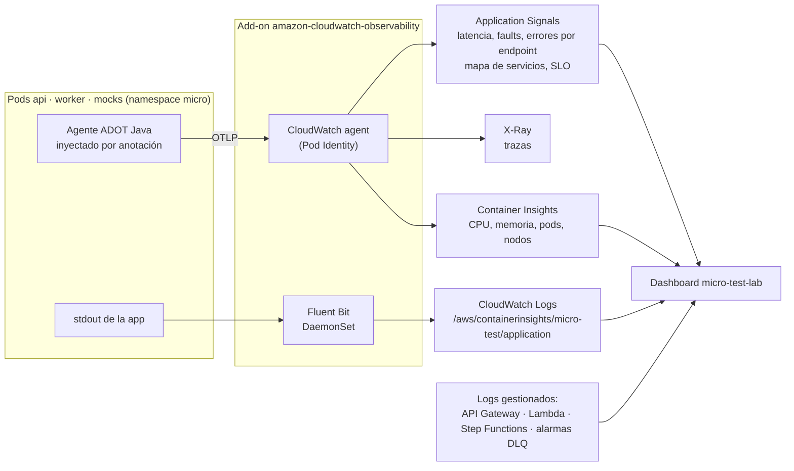

# Observabilidad en CloudWatch

Qué se ve, de dónde sale y dónde mirarlo. Decisión N21. Escalado: [ESCALADO.md](ESCALADO.md).



## Qué responde cada fuente

| Pregunta | Dónde | Origen |
|---|---|---|
| ¿Qué endpoint de la API es lento o falla? | Application Signals → Services → `api` → Operations | Agente ADOT (sin cambios de código) |
| ¿A quién llama la API y cuánto tarda (mocks, S3, PostgreSQL)? | Application Signals → Service map; trazas en X-Ray | Agente ADOT |
| ¿Cuántos pods y nodos hay, cuánta CPU usan? | Container Insights; dashboard paneles 7–8 | CloudWatch agent |
| ¿Qué pasó con una venta concreta? | Logs Insights sobre `/aws/containerinsights/micro-test/application` filtrando `saleId` | Fluent Bit (logs `process_step`, `outbox_published`) |
| ¿Dónde se detuvo el workflow? | Step Functions → ejecución `messageId-receiveCount`; log group `/aws/vendedlogs/states/micro-test-purchase` | Step Functions |
| ¿Entran compras? ¿Hay throttling? | Dashboard panel 1; `/aws/apigateway/micro-test-public` | API Gateway |
| ¿La admisión está al tope? | Dashboard panel 3 (ejecuciones activas = N) | Lambda |
| ¿Algo terminó en DLQ? | Alarma `micro-test-purchases-dlq-not-empty`; `/aws/events/micro-test-alarms` | CloudWatch + EventBridge |

## Dónde se configura

| Pieza | Archivo |
|---|---|
| Add-on, rol Pod Identity del agente, log groups con retención | `aws/cloudformation/05-eks.yaml` |
| Application Signals (activación de cuenta) y dashboard | `aws/cloudformation/08-observability.yaml` |
| Anotación `instrumentation.opentelemetry.io/inject-java` en los Deployments | `aws/kubernetes/app.yaml` |
| Imagen sin agente embebido (lo inyecta el add-on) | `Dockerfile` |

## Consultas útiles (Logs Insights)

```text
# Recorrido de una venta
SOURCE '/aws/containerinsights/micro-test/application'
| fields @timestamp, kubernetes.labels.app as app, log
| filter log like /<saleId>/
| sort @timestamp asc

# Pasos reconciliados (acuse perdido en CM/Aseguradora)
SOURCE '/aws/containerinsights/micro-test/application'
| filter log like /outcome=RECONCILED/
| stats count() by bin(5m)
```

## Costo y límites

- Container Insights con observabilidad mejorada y Application Signals se cobran por uso
  (observaciones, señales, GB de logs). Retención de logs: 7 días (`LogRetentionDays`).
- Para apagarlo: quitar la anotación de los Deployments (sin trazas) o eliminar el add-on en 05.
- Pendiente: propagar el contexto de traza desde Step Functions a la API. Hoy la correlación
  entre una ejecución y sus llamadas es por `X-Correlation-Id` = `saleId`, no por traceId.
