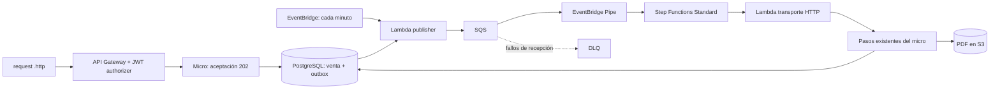

# Compras reales en LocalStack laptop

Micro/RDS/Istio desplegados por usuario desde WSL. Red Lambda reparada.
Compra autenticada → outbox → publisher periódico → SQS → Pipe → SFN → PDF
ya ejecutada contra laptop; revisa evidencias y límites de aceptación actuales.
Resultados ejecutados y límites: [VALIDATION.md](VALIDATION.md).

Confirmado: tú ejecutarás comandos WSL y necesitas **Karpenter con nodos reales**.
Ver [Karpenter + Cluster API + Docker](../karpenter/README.md): clúster adicional
con workers ejecutables. Compras/Istio permanecen en EKS/k3d existente; ese módulo
no escala sus Managed Node Groups. Instalación separada, runtime todavía pendiente.

## 1. Completar desde WSL2

Abre este mismo repositorio, con estos cambios, **dentro de WSL de la laptop**.
Los cambios de esta sesión siguen locales; hacer `git pull` no los descarga.
Puedes generar ZIP con `python3 localstack/business/bundle.py`, copiarlo a laptop
y descomprimirlo fuera del repositorio. Desde WSL, `python3 /ruta/al/bundle/apply.py
--repo /ruta/al/repositorio` comprueba todos los archivos; repetir con `--apply`
solo si dice CHECK OK. Conflictos se conservan. Una copia limpia del commit
`6a96af73b7593655d3c0d43f5827489ae7562cd5` sirve como destino alternativo; no requiere
recrear recursos LocalStack. ZIP excluye tokens, kubeconfig, `.venv` y `.state`.

Requisitos: Docker Desktop integrado con WSL, Python, kubectl, k3d e istioctl 1.31.3.
El script utiliza el emulador ya publicado en 4566; no crea otro ni lo reinicia.

Antes de desplegar, puedes inspeccionar Kubernetes sin instalar Istio:

```bash
export PATH="$HOME/.local/bin:$PATH"
localstack/.venv/bin/python localstack/business/wsl.py --inspect \
  --network k3d-micro-test-local-50dacdf7
```

Esa red es la observada en esta laptop; si cambia, usa nombre devuelto por inspección
Docker. El clúster k3d observado es `micro-test-local-50dacdf7`, mientras EKS se llama
`micro-test-local-eks`. El script selecciona por red compartida, comprueba labels
Docker, puerto API publicado y que IDs de workers pertenezcan a EKS según tags EC2.
TLS usa CA interna del kubeconfig k3d. **No comparar esa CA con certificado EKS**:
el endpoint EKS de esta laptop devuelve certificado de `localhost.localstack.cloud`,
distinto del interno. No se desactiva validación TLS. `--inspect` solo consulta APIs
y guarda kubeconfig/reporte locales;
no instala Istio, modifica nodos, construye imágenes ni activa publisher/Pipe.
Reporte muestra versión real, labels, taints y Ready, sin tokens Docker/Kubernetes.
No compartir JSON completo de `k3d cluster list`: contiene tokens del clúster.

`k3d version` muestra versión k3s predeterminada del CLI, no la de este clúster.
Inspección WSL confirmó servidor `v1.34.9+k3s1`, tres workers y control plane Ready.
Cliente instalado `kubectl v1.36.1` excede skew admitido de un minor. Para este lab,
descarga cliente v1.34.9 en `.state/tools/` y antepón esa carpeta al PATH:

```bash
mkdir -p localstack/.state/tools &&
curl --fail --location --proto '=https' --proto-redir '=https' \
  https://dl.k8s.io/release/v1.34.9/bin/linux/amd64/kubectl \
  -o localstack/.state/tools/kubectl &&
printf '%s  %s\n' '73bb6f5063caadae1e73a39de018d8ad21755984bea35358484db817859e7634' \
  'localstack/.state/tools/kubectl' | sha256sum --check - &&
chmod +x localstack/.state/tools/kubectl
export PATH="$PWD/localstack/.state/tools:$HOME/.local/bin:$PATH"
```

No reemplaza kubectl global ni cambia servidor. Referencia:
[skew soportado de kubectl](https://kubernetes.io/releases/version-skew-policy/#kubectl).
Si inspección confirma Kubernetes soportado (1.32–1.37), instala CLI Istio fijado
en carpeta local del repositorio, sin instalar todavía componentes en Kubernetes:

```bash
mkdir -p localstack/.state/tools &&
curl --fail --location --proto '=https' --proto-redir '=https' \
  https://github.com/istio/istio/releases/download/1.31.3/istio-1.31.3-linux-amd64.tar.gz \
  -o localstack/.state/tools/istio-1.31.3-linux-amd64.tar.gz &&
tar -xzf localstack/.state/tools/istio-1.31.3-linux-amd64.tar.gz -C localstack/.state/tools

export PATH="$PWD/localstack/.state/tools:$PWD/localstack/.state/tools/istio-1.31.3/bin:$HOME/.local/bin:$PATH"
istioctl version --remote=false
```

Referencia: [matriz de soporte Istio](https://istio.io/latest/docs/releases/supported-releases/).
Si inspección detecta versión incompatible o faltan taints, conserva recursos y
comparte reporte antes de desplegar. No actualizar/recrear clúster para ocultarlo.

```bash
python3 -m venv localstack/.venv
localstack/.venv/bin/pip install -r localstack/requirements.txt

# Inspección, antes de modificar recursos.
localstack/.venv/bin/python localstack/business/business.py status \
  --endpoint http://127.0.0.1:4566

# Descubre contenedor/cluster existentes. Construye micro, prepara DB, prueba
# scheduling, Istio, NetworkPolicy, ECR; despliega negocio y activa publisher/Pipe.
localstack/.venv/bin/python localstack/business/wsl.py \
  --client-endpoint http://100.100.154.68:4566 \
  --network k3d-micro-test-local-50dacdf7
```

Usa `--client-endpoint http://127.0.0.1:4566` si descargarás PDFs desde la laptop.
El endpoint prefirmado se fija en configuración del micro: debe ser alcanzable
desde el cliente que descarga. Si LocalStack tiene varias redes Docker, el script
lista las observadas y exige seleccionar una con `--network NOMBRE_OBSERVADO`.

RDS es predeterminado. `--database postgres` elige explícitamente **otra base** en
StatefulSet/PVC; no mueve datos. El publisher usa NodePort 31543 solo en esa opción.
No elegir fallback para ocultar problemas de conexión de una base con datos.

Un fallo detiene el script y no equivale a despliegue aprobado. Si faltan workers,
revisar los Managed Node Groups existentes; `ACTIVE` no sustituye nodos Ready.
Si falla conexión Lambda → micro, revisar red Docker observada y
`LAMBDA_DOCKER_NETWORK`; no usar `localhost` para apuntar desde Lambda al pod.
No reiniciar LocalStack actual para cambiar variables sin preparar persistencia.

Si bootstrap ya escribió `kubernetes.json` con PASS y después falló ECR, puedes
retomar sin repetir Istio/build/probes. Conserva `.state/business-runtime.json`
generado por ese bootstrap y ejecuta desde WSL:

```bash
localstack/.venv/bin/python localstack/scripts/kube.py \
  --endpoint http://127.0.0.1:4566 \
  --k3d-cluster micro-test-local-50dacdf7 registry &&
localstack/.venv/bin/python localstack/business/business.py deploy \
  --endpoint http://127.0.0.1:4566 \
  --runtime localstack/.state/business-runtime.json &&
localstack/.venv/bin/python localstack/business/business.py start \
  --endpoint http://127.0.0.1:4566
```

Registry conserva hostname devuelto por ECR:
`000000000000.dkr.ecr.us-east-1.localhost.localstack.cloud:4566`.
Reescribirlo a `127.0.0.1:4566` pierde routing por Host y devolvió 404 en `/v2/`.
Se validan cuenta, región, repositorio, endpoint de autorización y DNS loopback.
Docker usa credenciales temporales aisladas; no cambia insecure registries,
configuración global ni TLS. Referencia: [ECR endpoint strategy](https://docs.localstack.cloud/aws/services/ecr/#endpoint-strategy).
Prueba HTTPS GET `/v2/` con hostname correcto respondió 200 desde Mac; login,
push y pull Docker requieren comprobación efectiva en WSL.

En despliegues posteriores, `--update` permite cambios de código/configuración
cuando el template vivo coincide con el recibo anterior de `.state/business/`.
El script rechaza reemplazos de recursos de datos y modificaciones ajenas al recibo.
Conserva ese directorio local para reconocer tus propios despliegues.

**No desplegar `micro-api` opcional de la guía anterior junto a este flujo:** es
un proxy sin authorizer. La API de negocio expone solo las tres rutas públicas de
compras; las rutas internas quedan fuera de API Gateway.

## 2. Generar `.http` desde Mac

Después de completar WSL, desde la raíz del repositorio en Mac:

```bash
export AWS_PROFILE=localstack-laptop
export LAB_ENDPOINT=http://100.100.154.68:4566

localstack/.venv/bin/python localstack/business/business.py http \
  --endpoint "$LAB_ENDPOINT"
```

Abre `localstack/.state/business/purchase.http` en VS Code con **REST Client**.
Ese archivo lleva URL real de API Gateway, referencia fija y tres tokens locales:
válido, firma incorrecta y expirado. Está ignorado por Git, con permisos 0600.
Regenerarlo cambia referencia y tokens; token válido dura una hora.

1. Ejecuta `purchase`: debe responder **202** con `saleId`, `correlationId`, `eventId`.
2. Ejecuta `status` hasta **COMPLETED**. Publisher periódico puede tardar un minuto;
   el workflow tiene timeout de cuatro minutos.
3. Ejecuta descarga: recibe PDF desde S3. GET de estado renueva URL por 15 minutos.
4. Repite `purchase` sin cambiar referencia: mismos IDs; un evento lógico inicial.

Plantilla versionada: [requests/purchase.http](requests/purchase.http). Sus marcadores
`__BASE_URL__` y `__TOKEN__` se sustituyen solo con recursos reales desplegados.
No contiene un API ID inventado ni funciona antes de desplegar negocio.

Los scripts usan endpoint explícito y credenciales ficticias propias, verifican
LocalStack y cuenta `000000000000`, y eliminan sesiones AWS heredadas. El perfil
`localstack-laptop` se utiliza en tus comandos CLI, no como fuente de credenciales
de esos scripts. Nunca apuntan a AWS real ni al host anterior.

## 3. Qué ejecuta la arquitectura



La Lambda transporte hace HTTP local; no es una integración HTTP nativa de AWS
Step Functions. La lógica de documento, póliza, upload, finalización y liberación
sigue en `WorkflowService`, con una instancia y una base compartida.

Contrato `PurchaseAccepted` v1: `eventId`, `type`, `version`, `saleId`,
`correlationId` (= `saleId`) y `generation`. Pipe entrega lote SQS de tamaño uno;
normalizador valida `eventSource`, JSON, UUIDs y versión antes de reclamar venta.

Aceptación usa `externalReference` como clave idempotente; mismo contenido conserva
venta/evento y contenido distinto devuelve **409**. Venta y outbox se confirman
en la misma transacción. No se publican eventos desde el request HTTP.

Publisher utiliza `FOR UPDATE SKIP LOCKED`, mantiene lock durante `SendMessage` y
marca publicado tras respuesta exitosa. Error deja evento pendiente, registra
intento y espera cinco segundos antes de reintento. Una caída después de envío
puede duplicar mensaje: **entrega al menos una vez**, sin promesa exactly-once.

Cada workflow reclama evento con su execution ARN. Otra ejecución del mismo
evento termina sin repetir trabajo. Venta se bloquea por fila en cada paso;
IDs/PDF se reutilizan. Un PUT a S3 seguido de rollback SQL puede producir otra
versión del mismo objeto al reintentar: mismo key/bytes, un registro lógico.

Estados: `ACCEPTED → PROCESSING → COMPLETED` o `FAILED`. Catch registra error en
venta; SFN también termina FAILED. Si se pierde la ejecución, una aceptación o
procesamiento cuyo lease de cinco minutos venció muestra `recoverable=true`.
`POST /purchases/{saleId}/retry` crea una nueva generación sin fallos de práctica,
reutilizando pasos terminados. Una ejecución vieja no puede sobrescribir estado
de la nueva. Repetir retry mientras la nueva está activa devuelve 409: consultar
estado antes de volver a pedir recuperación.

Con Standard + FIRE_AND_FORGET, SQS puede confirmarse al iniciar SFN. Un error
posterior de negocio **no va automáticamente a DLQ**. Se consulta en venta/SFN y
se recupera explícitamente. Mensaje inválido falla normalizador/SFN, no produce
venta exitosa. El test DLQ utiliza colas diagnósticas separadas.

JWT local: HS256, secreto aleatorio en Secrets Manager, issuer `micro-test-local`,
audience `micro-test-local-purchases`, `sub` obligatorio, `iat`/`exp` comprobados,
TTL máximo una hora, cache authorizer deshabilitada. Todos los usuarios del lab
comparten ventas; no implementa tenants. Endpoints internos confían en red privada
e identidad de gateway Istio; no son endpoints públicos con JWT propio.

La aplicación habilita compras solo con `LAB_PURCHASES_ENABLED=true`. No hay nuevo
perfil Spring. Los endpoints antiguos conservan rutas/respuestas principales;
ahora referencia conflictiva responde 409, pasos concurrentes se serializan,
COMPLETED no retrocede y requiere documento liberado.

## 4. Ejercicios y verificaciones

El `.http` incluye venta normal, duplicado, conflicto, fallo transitorio,
permanente, recuperación y tokens ausente/inválido/expirado.

```bash
# Flujo completo con publisher periódico; pruebas dejan ventas/documentos para observar.
localstack/.venv/bin/python localstack/business/business.py test --endpoint "$LAB_ENDPOINT"

# Permisos reales; debe fallar si IAM no deniega. Actualmente FAIL en laptop.
localstack/.venv/bin/python localstack/business/business.py iam --endpoint "$LAB_ENDPOINT"

# DLQ separada: requiere Pipe diagnóstico STOPPED y sus colas vacías.
localstack/.venv/bin/python localstack/business/business.py dlq --endpoint "$LAB_ENDPOINT"
```

`test` exige 202/COMPLETED, evento outbox publicado, ejecución SFN correlacionada,
PDF real y descarga idéntica; verifica dos fallos transitorios en history, FAILED
permanente y recuperación; simula caída después de SendMessage y exige dos
ejecuciones para un evento. También envía versión inválida y exige SFN FAILED.
No marca PASS ante timeout, excepción o recurso ausente. Suite no reinicia emulador.

Para practicar outbox manualmente, detén la programación con comando CLI de abajo,
crea compra en `.http` y copia su `eventId`:

```bash
localstack/.venv/bin/python localstack/business/business.py pause-publisher --endpoint "$LAB_ENDPOINT"

localstack/.venv/bin/python localstack/business/business.py publish --endpoint "$LAB_ENDPOINT" \
  --event-id EVENT_ID --crash-after-send
# FunctionError esperado; outbox continúa pendiente y registra LAB_CRASH_AFTER_SEND.
# Espera al menos cinco segundos; consulta estado y publica de nuevo.
localstack/.venv/bin/python localstack/business/business.py publish --endpoint "$LAB_ENDPOINT" \
  --event-id EVENT_ID

localstack/.venv/bin/python localstack/business/business.py resume-publisher --endpoint "$LAB_ENDPOINT"
```

El `PASS` del comando con `--crash-after-send` significa **fallo inyectado observado**;
la suite `test` es quien demuestra recuperación e idempotencia posteriores.

Observación desde Mac o laptop, siempre con endpoint apropiado:

```bash
aws --profile localstack-laptop --endpoint-url "$LAB_ENDPOINT" --region us-east-1 \
  logs tail /aws/lambda/micro-test-local-publisher --since 10m
aws --profile localstack-laptop --endpoint-url "$LAB_ENDPOINT" --region us-east-1 \
  logs tail /aws/lambda/micro-test-local-transport --since 10m
aws --profile localstack-laptop --endpoint-url "$LAB_ENDPOINT" --region us-east-1 \
  stepfunctions list-executions \
  --state-machine-arn arn:aws:states:us-east-1:000000000000:stateMachine:micro-test-local-purchases
aws --profile localstack-laptop --endpoint-url "$LAB_ENDPOINT" --region us-east-1 \
  stepfunctions get-execution-history --execution-arn ARN_COPIADO_DEL_STATUS
```

Reportes nuevos: `localstack/reports/laptop/<sesión>/`. No sobrescriben reportes de
PC anterior. `.state/business/` contiene paquetes, recibos y tokens locales.

## 5. Persistencia y parada

**Actualmente `persistence=disabled`: no reiniciar para probar durabilidad.**
Preparar primero backups locales verificables de PostgreSQL, estado LocalStack y
volúmenes k3d/PVC. Snapshot de APIs por sí solo no demuestra recuperación de DB ni
discos de Kubernetes. Revisar/restaurar backups en entorno aislado antes de tocar
el emulador con datos. No subir snapshots a Cloud Pods/S3 remoto.

Configuración requerida en el servicio LocalStack existente, después de asegurar
esos datos: `PERSISTENCE=1`, `ENFORCE_IAM=1`, volumen durable en `/var/lib/localstack`,
misma imagen/version de LocalStack y red Lambda compatible. Cambiar variables
requiere recreación controlada; no se hizo desde esta sesión sin acceso WSL.
Consultar [persistencia oficial](https://docs.localstack.cloud/aws/developer-tools/snapshots/persistence/),
[snapshots locales](https://docs.localstack.cloud/aws/developer-tools/snapshots/saving-snapshots-locally/)
y [enforcement IAM](https://docs.localstack.cloud/aws/developer-tools/security-testing/iam-policy-enforcement/).

Cuando persistencia esté preparada y exista compra COMPLETED:

```bash
localstack/.venv/bin/python localstack/business/business.py snapshot \
  --endpoint "$LAB_ENDPOINT" --sale-id SALE_ID

# Reinicio controlado desde WSL SOLO tras verificar backups, mounts y persistencia.
# No ejecutar bootstrap, nuevas compras ni publish antes de verificar originales.

localstack/.venv/bin/python localstack/business/business.py verify-snapshot \
  --endpoint "$LAB_ENDPOINT"
```

La verificación lee primero objeto S3 original, compara SHA/versionId, luego venta,
outbox, documento y ejecución SFN originales. No regenera contenido. El snapshot
es evidencia para comparar, **no un backup**. Reinicio del laboratorio todavía
PENDIENTE y requiere observar recuperación de workers/pods también.

Parar procesamiento conservando datos:

```bash
localstack/.venv/bin/python localstack/business/business.py stop --endpoint "$LAB_ENDPOINT"
```

Esto deshabilita programación y detiene Pipe mediante `UpdatePipe`. Ejecuciones ya
iniciadas pueden terminar. No borra colas, ventas, outbox, PDFs, secretos ni PVCs.
Después puedes escalar micro/gateway con `kube.py ... stop` de la guía base. No usar
`docker compose down -v`, prune global ni cleanup destructivo para esta práctica.

## 6. Pruebas de desarrollo reproducibles

`PurchaseIntegrationTest` usa PostgreSQL real y S3 simulado; `PurchaseS3IntegrationTest`
usa S3 real de laptop; ninguno representa API Gateway/Pipe/SFN completo. Se exige
base aislada **`docs_business_test`**. No usar base `docs` del laboratorio.

En Mac con PostgreSQL 16 instalado, inicializar una vez un directorio de pruebas:

```bash
mkdir -p localstack/.state/pg-business-tests
/opt/homebrew/opt/postgresql@16/bin/initdb \
  -D localstack/.state/pg-business-tests/data -U docs -A trust --no-locale --encoding=UTF8
/opt/homebrew/opt/postgresql@16/bin/pg_ctl \
  -D localstack/.state/pg-business-tests/data -l localstack/.state/pg-business-tests/postgres.log \
  -o '-h 127.0.0.1 -p 15432 -k /tmp' start
/opt/homebrew/opt/postgresql@16/bin/createdb -h 127.0.0.1 -p 15432 -U docs docs_business_test
```

Si directorio/base ya existen, no repetir `initdb`/`createdb`; arrancar el cluster
aislado existente. Ejecutar suites en secuencia: comparten esa base de pruebas.

```bash
export JAVA_HOME=$(/usr/libexec/java_home -v 17)
export LAB_TEST_POSTGRES=true
export DATABASE_URL=jdbc:postgresql://127.0.0.1:15432/docs_business_test
export DATABASE_USERNAME=docs DATABASE_PASSWORD=docs
export AWS_EC2_METADATA_DISABLED=true

localstack/.venv/bin/python localstack/business/business.py status --endpoint "$LAB_ENDPOINT"
LAB_TEST_S3_ENDPOINT="$LAB_ENDPOINT" mvn test
localstack/.venv/bin/python localstack/business/business.py package
localstack/.venv/bin/python -m unittest discover -s localstack/business/tests -v
localstack/.venv/bin/python -m unittest discover -s localstack/scripts -p 'test_*.py' -v
localstack/.venv/bin/python localstack/business/business.py validate

/opt/homebrew/opt/postgresql@16/bin/pg_ctl -D localstack/.state/pg-business-tests/data stop
```

Sin variables opt-in, pruebas PostgreSQL/S3 aparecen **SKIPPED**, no aprobadas.
La prueba S3 deja su PDF y evidencia en `.state/business/s3-component.json`.
Probe Lambda/RDS disponible aparte:

```bash
localstack/.venv/bin/python localstack/business/business.py probe \
  --endpoint "$LAB_ENDPOINT"
```

Probe usa código publisher real y consulta DB/secreto/schema sin insertar ventas.
`healthy=true` solo demuestra conexión; `schemaReady=false` significa bootstrap
de aplicación pendiente. Artefactos y probe tienen stacks propios, sin disparador.
Dependencias `python-dateutil` y `scramp` están fijadas por incompatibilidades
detectadas con botocore y conexión TLS real a PostgreSQL.

REST Client resuelve referencias entre requests después de ejecutar la request
nombrada; `# @no-redirect` impide redirecciones. [Documentación del proyecto](https://github.com/Huachao/vscode-restclient).

## Diagnóstico: stack creado, RoleArn y timeouts Lambda

Si `deploy` terminó CREATE_COMPLETE y luego falló por `Missing required parameter:
"RoleArn"`, aplica el parche `micro-test-pipe-fix.zip`. La corrección conserva el rol
que ya pertenece al Pipe; no necesita reconstruir micro ni repetir ECR.

Antes de activar compras, ejecuta en WSL desde la raíz del repositorio:

```bash
localstack/.venv/bin/python localstack/business/network_inspect.py
```

Invoca operaciones health sin insertar ventas y obtiene inventario Docker de
LocalStack, k3d del laboratorio y runtimes publisher/transport/authorizer.
Solo imprime nombres, redes, IPs y claves de configuración permitidas. No conecta
redes, reinicia servicios ni activa disparadores. Un runtime ausente puede estar
inactivo; no implica que su función no exista. `INSPECTED` no significa E2E PASS.

En esta sesión ambos health fallaron hacia las IPs Docker del runtime. Hay que
correlacionar redes antes de corregir transporte. No reiniciar LocalStack mientras
persistencia esté deshabilitada. No repetir bootstrap ni activar `start` todavía.

Referencias: [UpdatePipe requiere RoleArn](https://docs.aws.amazon.com/eventbridge/latest/pipes-reference/API_UpdatePipe.html);
[configuración de red Lambda](https://docs.localstack.cloud/aws/customization/configuration-options/#lambda).

### Reparar redes separadas sin reiniciar

Para la instalación observada, Lambda usa `bridge`; k3d usa su propia red.
Aplica `micro-test-lambda-network-fix.zip` y ejecuta en WSL:

```bash
cd /mnt/c/Users/josue/source/repos/micro-test-local-lab
export PATH="$PWD/localstack/.state/tools:$HOME/.local/bin:$PATH"
localstack/.venv/bin/python localstack/business/wsl.py \
  --repair-lambda-network \
  --network k3d-micro-test-local-50dacdf7
```

Este modo verifica EKS/k3d y exige Pipe STOPPED/Scheduler DISABLED. Conecta un único
nodo Ready propio a `bridge` si falta, con prioridad de gateway -1. No modifica
rutas globales ni reinicia contenedores. Usa IP de LocalStack en esa red para AWS
API/RDS y la IP del nodo en esa misma red para NodePort. Preserva base/puerto y
respalda parámetros anteriores en el reporte. Actualiza stack con recibo de
despliegue existente; rechaza cambios ajenos. No construye imagen ni repite ECR.

`Runtime health PASS` exige publisher → DB/outbox y transport → health del micro.
Pipe y Scheduler permanecen detenidos. Después:

```bash
localstack/.venv/bin/python localstack/business/business.py start --endpoint http://127.0.0.1:4566 &&
localstack/.venv/bin/python localstack/business/business.py test --endpoint http://127.0.0.1:4566 &&
localstack/.venv/bin/python localstack/business/business.py http --endpoint http://127.0.0.1:4566
```

`http` genera `.state/business/purchase.http` con token local; abrirlo en REST Client
y ejecutar solicitudes en orden. Para ejecutarlo desde Mac, generar allí con endpoint
`http://100.100.154.68:4566`. No guardar el archivo generado en Git.

La conexión del nodo sirve también a nuevos runtimes Lambda que nazcan en `bridge`;
no depende de conectar manualmente contenedores Lambda efímeros. Si k3d recrea ese
nodo o cambian IPs/redes, detener disparadores y repetir reparación. Bootstrap
normal también prepara estos endpoints antes de desplegar negocio.
Esta adaptación Docker no demuestra paridad VPC/SG ni persistencia de datos.

Docker soporta [conexión de contenedores y prioridad de gateway](https://docs.docker.com/reference/cli/docker/network/connect/).
Las [redes bridge aíslan tráfico entre redes por defecto](https://docs.docker.com/engine/network/drivers/bridge/).

### Disparador periódico corregido

Esta instalación devolvió ENABLED sin ejecutar una regla Events creada deshabilitada;
tras refrescar destino comenzó a ejecutar, pero DisableRule no detuvo invocaciones.
La prueba de pausa quedó FAIL. Se conservó esa evidencia y se retiró únicamente
su destino publisher. La regla original permanece DISABLED/sin targets.

`micro-test-local-business-scheduler` declara rol limitado a InvokeFunction sobre
publisher y EventBridge Scheduler `rate(1 minute)`. `start/stop` administran Scheduler
y Pipe; `pause-publisher/resume-publisher` solo Scheduler. Usa scripts actualizados;
no uses EnableRule/DisableRule para controlar publicación.

Un despliegue del stack principal puede reponer el target declarado originalmente.
El script actualizado pausa Scheduler y desacopla ese target antes/después del
update; `start` también lo verifica. No ejecutar scripts antiguos simultáneamente.
No se eliminan ventas, outbox, colas, documentos ni workflow.

Tokens se emiten según reloj del emulador para evitar `iat` futuro por diferencias
Mac/WSL. Conservan validación de firma/claims y duración máxima de una hora.

Prueba de pausa real durante 75 segundos y recuperación automática después de reanudar:

```bash
localstack/.venv/bin/python localstack/business/business.py test-pause --endpoint "$LAB_ENDPOINT"
```

Ejecutar con flujo iniciado y sin otro proceso cambiando Scheduler. Crea venta de
práctica; restaura programación al terminar incluso ante error. No reinicia emulador.
