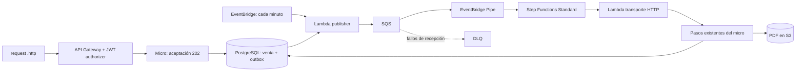

# Compras reales en LocalStack laptop

Código implementado. Despliegue completo todavía **PENDIENTE**: desde Mac no hubo
acceso SSH autenticado a WSL ni acceso directo a Kubernetes. La inspección encontró
diez stacks base, RDS accesible desde Lambda, y ninguna tabla `sales`/`outbox` en RDS.
Resultados ejecutados y límites: [VALIDATION.md](VALIDATION.md).

Confirmado: tú ejecutarás comandos WSL y necesitas **Karpenter con nodos reales**.
Ver [Karpenter + Cluster API + Docker](../karpenter/README.md): clúster adicional
con workers ejecutables. Compras/Istio permanecen en EKS/k3d existente; ese módulo
no escala sus Managed Node Groups. Instalación separada, runtime todavía pendiente.

## 1. Completar desde WSL2

Abre este mismo repositorio, con estos cambios, **dentro de WSL de la laptop**.
Los cambios de esta sesión siguen locales; hacer `git pull` no los descarga.
Puedes generar ZIP con `python3 localstack/business/bundle.py`, copiarlo a laptop
y descomprimirlo fuera del repositorio. Desde WSL, `python3 /ruta/al/bundle/apply.py
--repo /ruta/al/repositorio` comprueba todos los archivos; repetir con `--apply`
solo si dice CHECK OK. Conflictos se conservan. Una copia limpia del commit
`6a96af73b7593655d3c0d43f5827489ae7562cd5` sirve como destino alternativo; no requiere
recrear recursos LocalStack. ZIP excluye tokens, kubeconfig, `.venv` y `.state`.

Requisitos: Docker Desktop integrado con WSL, Python, kubectl, k3d e istioctl 1.31.3.
El script utiliza el emulador ya publicado en 4566; no crea otro ni lo reinicia.

```bash
python3 -m venv localstack/.venv
localstack/.venv/bin/pip install -r localstack/requirements.txt

# Inspección, antes de modificar recursos.
localstack/.venv/bin/python localstack/business/business.py status \
  --endpoint http://127.0.0.1:4566

# Descubre contenedor/cluster existentes. Construye micro, prepara DB, prueba
# scheduling, Istio, NetworkPolicy, ECR; despliega negocio y activa publisher/Pipe.
localstack/.venv/bin/python localstack/business/wsl.py \
  --client-endpoint http://100.100.154.68:4566
```

Usa `--client-endpoint http://127.0.0.1:4566` si descargarás PDFs desde la laptop.
El endpoint prefirmado se fija en configuración del micro: debe ser alcanzable
desde el cliente que descarga. Si LocalStack tiene varias redes Docker, el script
lista las observadas y exige seleccionar una con `--network NOMBRE_OBSERVADO`.

RDS es predeterminado. `--database postgres` elige explícitamente **otra base** en
StatefulSet/PVC; no mueve datos. El publisher usa NodePort 31543 solo en esa opción.
No elegir fallback para ocultar problemas de conexión de una base con datos.

Un fallo detiene el script y no equivale a despliegue aprobado. Si faltan workers,
revisar los Managed Node Groups existentes; `ACTIVE` no sustituye nodos Ready.
Si falla conexión Lambda → micro, revisar red Docker observada y
`LAMBDA_DOCKER_NETWORK`; no usar `localhost` para apuntar desde Lambda al pod.
No reiniciar LocalStack actual para cambiar variables sin preparar persistencia.

En despliegues posteriores, `--update` permite cambios de código/configuración
cuando el template vivo coincide con el recibo anterior de `.state/business/`.
El script rechaza reemplazos de recursos de datos y modificaciones ajenas al recibo.
Conserva ese directorio local para reconocer tus propios despliegues.

**No desplegar `micro-api` opcional de la guía anterior junto a este flujo:** es
un proxy sin authorizer. La API de negocio expone solo las tres rutas públicas de
compras; las rutas internas quedan fuera de API Gateway.

## 2. Generar `.http` desde Mac

Después de completar WSL, desde la raíz del repositorio en Mac:

```bash
export AWS_PROFILE=localstack-laptop
export LAB_ENDPOINT=http://100.100.154.68:4566

localstack/.venv/bin/python localstack/business/business.py http \
  --endpoint "$LAB_ENDPOINT"
```

Abre `localstack/.state/business/purchase.http` en VS Code con **REST Client**.
Ese archivo lleva URL real de API Gateway, referencia fija y tres tokens locales:
válido, firma incorrecta y expirado. Está ignorado por Git, con permisos 0600.
Regenerarlo cambia referencia y tokens; token válido dura una hora.

1. Ejecuta `purchase`: debe responder **202** con `saleId`, `correlationId`, `eventId`.
2. Ejecuta `status` hasta **COMPLETED**. Publisher periódico puede tardar un minuto;
   el workflow tiene timeout de cuatro minutos.
3. Ejecuta descarga: recibe PDF desde S3. GET de estado renueva URL por 15 minutos.
4. Repite `purchase` sin cambiar referencia: mismos IDs; un evento lógico inicial.

Plantilla versionada: [requests/purchase.http](requests/purchase.http). Sus marcadores
`__BASE_URL__` y `__TOKEN__` se sustituyen solo con recursos reales desplegados.
No contiene un API ID inventado ni funciona antes de desplegar negocio.

Los scripts usan endpoint explícito y credenciales ficticias propias, verifican
LocalStack y cuenta `000000000000`, y eliminan sesiones AWS heredadas. El perfil
`localstack-laptop` se utiliza en tus comandos CLI, no como fuente de credenciales
de esos scripts. Nunca apuntan a AWS real ni al host anterior.

## 3. Qué ejecuta la arquitectura



La Lambda transporte hace HTTP local; no es una integración HTTP nativa de AWS
Step Functions. La lógica de documento, póliza, upload, finalización y liberación
sigue en `WorkflowService`, con una instancia y una base compartida.

Contrato `PurchaseAccepted` v1: `eventId`, `type`, `version`, `saleId`,
`correlationId` (= `saleId`) y `generation`. Pipe entrega lote SQS de tamaño uno;
normalizador valida `eventSource`, JSON, UUIDs y versión antes de reclamar venta.

Aceptación usa `externalReference` como clave idempotente; mismo contenido conserva
venta/evento y contenido distinto devuelve **409**. Venta y outbox se confirman
en la misma transacción. No se publican eventos desde el request HTTP.

Publisher utiliza `FOR UPDATE SKIP LOCKED`, mantiene lock durante `SendMessage` y
marca publicado tras respuesta exitosa. Error deja evento pendiente, registra
intento y espera cinco segundos antes de reintento. Una caída después de envío
puede duplicar mensaje: **entrega al menos una vez**, sin promesa exactly-once.

Cada workflow reclama evento con su execution ARN. Otra ejecución del mismo
evento termina sin repetir trabajo. Venta se bloquea por fila en cada paso;
IDs/PDF se reutilizan. Un PUT a S3 seguido de rollback SQL puede producir otra
versión del mismo objeto al reintentar: mismo key/bytes, un registro lógico.

Estados: `ACCEPTED → PROCESSING → COMPLETED` o `FAILED`. Catch registra error en
venta; SFN también termina FAILED. Si se pierde la ejecución, una aceptación o
procesamiento cuyo lease de cinco minutos venció muestra `recoverable=true`.
`POST /purchases/{saleId}/retry` crea una nueva generación sin fallos de práctica,
reutilizando pasos terminados. Una ejecución vieja no puede sobrescribir estado
de la nueva. Repetir retry mientras la nueva está activa devuelve 409: consultar
estado antes de volver a pedir recuperación.

Con Standard + FIRE_AND_FORGET, SQS puede confirmarse al iniciar SFN. Un error
posterior de negocio **no va automáticamente a DLQ**. Se consulta en venta/SFN y
se recupera explícitamente. Mensaje inválido falla normalizador/SFN, no produce
venta exitosa. El test DLQ utiliza colas diagnósticas separadas.

JWT local: HS256, secreto aleatorio en Secrets Manager, issuer `micro-test-local`,
audience `micro-test-local-purchases`, `sub` obligatorio, `iat`/`exp` comprobados,
TTL máximo una hora, cache authorizer deshabilitada. Todos los usuarios del lab
comparten ventas; no implementa tenants. Endpoints internos confían en red privada
e identidad de gateway Istio; no son endpoints públicos con JWT propio.

La aplicación habilita compras solo con `LAB_PURCHASES_ENABLED=true`. No hay nuevo
perfil Spring. Los endpoints antiguos conservan rutas/respuestas principales;
ahora referencia conflictiva responde 409, pasos concurrentes se serializan,
COMPLETED no retrocede y requiere documento liberado.

## 4. Ejercicios y verificaciones

El `.http` incluye venta normal, duplicado, conflicto, fallo transitorio,
permanente, recuperación y tokens ausente/inválido/expirado.

```bash
# Flujo completo con publisher periódico; pruebas dejan ventas/documentos para observar.
localstack/.venv/bin/python localstack/business/business.py test --endpoint "$LAB_ENDPOINT"

# Permisos reales; debe fallar si IAM no deniega. Actualmente FAIL en laptop.
localstack/.venv/bin/python localstack/business/business.py iam --endpoint "$LAB_ENDPOINT"

# DLQ separada: requiere Pipe diagnóstico STOPPED y sus colas vacías.
localstack/.venv/bin/python localstack/business/business.py dlq --endpoint "$LAB_ENDPOINT"
```

`test` exige 202/COMPLETED, evento outbox publicado, ejecución SFN correlacionada,
PDF real y descarga idéntica; verifica dos fallos transitorios en history, FAILED
permanente y recuperación; simula caída después de SendMessage y exige dos
ejecuciones para un evento. También envía versión inválida y exige SFN FAILED.
No marca PASS ante timeout, excepción o recurso ausente. Suite no reinicia emulador.

Para practicar outbox manualmente, detén la programación con comando CLI de abajo,
crea compra en `.http` y copia su `eventId`:

```bash
aws --profile localstack-laptop --endpoint-url "$LAB_ENDPOINT" --region us-east-1 \
  events disable-rule --name micro-test-local-publisher

localstack/.venv/bin/python localstack/business/business.py publish --endpoint "$LAB_ENDPOINT" \
  --event-id EVENT_ID --crash-after-send
# FunctionError esperado; outbox continúa pendiente y registra LAB_CRASH_AFTER_SEND.
# Espera al menos cinco segundos; consulta estado y publica de nuevo.
localstack/.venv/bin/python localstack/business/business.py publish --endpoint "$LAB_ENDPOINT" \
  --event-id EVENT_ID

aws --profile localstack-laptop --endpoint-url "$LAB_ENDPOINT" --region us-east-1 \
  events enable-rule --name micro-test-local-publisher
```

El `PASS` del comando con `--crash-after-send` significa **fallo inyectado observado**;
la suite `test` es quien demuestra recuperación e idempotencia posteriores.

Observación desde Mac o laptop, siempre con endpoint apropiado:

```bash
aws --profile localstack-laptop --endpoint-url "$LAB_ENDPOINT" --region us-east-1 \
  logs tail /aws/lambda/micro-test-local-publisher --since 10m
aws --profile localstack-laptop --endpoint-url "$LAB_ENDPOINT" --region us-east-1 \
  logs tail /aws/lambda/micro-test-local-transport --since 10m
aws --profile localstack-laptop --endpoint-url "$LAB_ENDPOINT" --region us-east-1 \
  stepfunctions list-executions \
  --state-machine-arn arn:aws:states:us-east-1:000000000000:stateMachine:micro-test-local-purchases
aws --profile localstack-laptop --endpoint-url "$LAB_ENDPOINT" --region us-east-1 \
  stepfunctions get-execution-history --execution-arn ARN_COPIADO_DEL_STATUS
```

Reportes nuevos: `localstack/reports/laptop/<sesión>/`. No sobrescriben reportes de
PC anterior. `.state/business/` contiene paquetes, recibos y tokens locales.

## 5. Persistencia y parada

**Actualmente `persistence=disabled`: no reiniciar para probar durabilidad.**
Preparar primero backups locales verificables de PostgreSQL, estado LocalStack y
volúmenes k3d/PVC. Snapshot de APIs por sí solo no demuestra recuperación de DB ni
discos de Kubernetes. Revisar/restaurar backups en entorno aislado antes de tocar
el emulador con datos. No subir snapshots a Cloud Pods/S3 remoto.

Configuración requerida en el servicio LocalStack existente, después de asegurar
esos datos: `PERSISTENCE=1`, `ENFORCE_IAM=1`, volumen durable en `/var/lib/localstack`,
misma imagen/version de LocalStack y red Lambda compatible. Cambiar variables
requiere recreación controlada; no se hizo desde esta sesión sin acceso WSL.
Consultar [persistencia oficial](https://docs.localstack.cloud/aws/developer-tools/snapshots/persistence/),
[snapshots locales](https://docs.localstack.cloud/aws/developer-tools/snapshots/saving-snapshots-locally/)
y [enforcement IAM](https://docs.localstack.cloud/aws/developer-tools/security-testing/iam-policy-enforcement/).

Cuando persistencia esté preparada y exista compra COMPLETED:

```bash
localstack/.venv/bin/python localstack/business/business.py snapshot \
  --endpoint "$LAB_ENDPOINT" --sale-id SALE_ID

# Reinicio controlado desde WSL SOLO tras verificar backups, mounts y persistencia.
# No ejecutar bootstrap, nuevas compras ni publish antes de verificar originales.

localstack/.venv/bin/python localstack/business/business.py verify-snapshot \
  --endpoint "$LAB_ENDPOINT"
```

La verificación lee primero objeto S3 original, compara SHA/versionId, luego venta,
outbox, documento y ejecución SFN originales. No regenera contenido. El snapshot
es evidencia para comparar, **no un backup**. Reinicio del laboratorio todavía
PENDIENTE y requiere observar recuperación de workers/pods también.

Parar procesamiento conservando datos:

```bash
localstack/.venv/bin/python localstack/business/business.py stop --endpoint "$LAB_ENDPOINT"
```

Esto deshabilita programación y detiene Pipe mediante `UpdatePipe`. Ejecuciones ya
iniciadas pueden terminar. No borra colas, ventas, outbox, PDFs, secretos ni PVCs.
Después puedes escalar micro/gateway con `kube.py ... stop` de la guía base. No usar
`docker compose down -v`, prune global ni cleanup destructivo para esta práctica.

## 6. Pruebas de desarrollo reproducibles

`PurchaseIntegrationTest` usa PostgreSQL real y S3 simulado; `PurchaseS3IntegrationTest`
usa S3 real de laptop; ninguno representa API Gateway/Pipe/SFN completo. Se exige
base aislada **`docs_business_test`**. No usar base `docs` del laboratorio.

En Mac con PostgreSQL 16 instalado, inicializar una vez un directorio de pruebas:

```bash
mkdir -p localstack/.state/pg-business-tests
/opt/homebrew/opt/postgresql@16/bin/initdb \
  -D localstack/.state/pg-business-tests/data -U docs -A trust --no-locale --encoding=UTF8
/opt/homebrew/opt/postgresql@16/bin/pg_ctl \
  -D localstack/.state/pg-business-tests/data -l localstack/.state/pg-business-tests/postgres.log \
  -o '-h 127.0.0.1 -p 15432 -k /tmp' start
/opt/homebrew/opt/postgresql@16/bin/createdb -h 127.0.0.1 -p 15432 -U docs docs_business_test
```

Si directorio/base ya existen, no repetir `initdb`/`createdb`; arrancar el cluster
aislado existente. Ejecutar suites en secuencia: comparten esa base de pruebas.

```bash
export JAVA_HOME=$(/usr/libexec/java_home -v 17)
export LAB_TEST_POSTGRES=true
export DATABASE_URL=jdbc:postgresql://127.0.0.1:15432/docs_business_test
export DATABASE_USERNAME=docs DATABASE_PASSWORD=docs
export AWS_EC2_METADATA_DISABLED=true

localstack/.venv/bin/python localstack/business/business.py status --endpoint "$LAB_ENDPOINT"
LAB_TEST_S3_ENDPOINT="$LAB_ENDPOINT" mvn test
localstack/.venv/bin/python localstack/business/business.py package
localstack/.venv/bin/python -m unittest discover -s localstack/business/tests -v
localstack/.venv/bin/python -m unittest discover -s localstack/scripts -p 'test_*.py' -v
localstack/.venv/bin/python localstack/business/business.py validate

/opt/homebrew/opt/postgresql@16/bin/pg_ctl -D localstack/.state/pg-business-tests/data stop
```

Sin variables opt-in, pruebas PostgreSQL/S3 aparecen **SKIPPED**, no aprobadas.
La prueba S3 deja su PDF y evidencia en `.state/business/s3-component.json`.
Probe Lambda/RDS disponible aparte:

```bash
localstack/.venv/bin/python localstack/business/business.py probe \
  --endpoint "$LAB_ENDPOINT"
```

Probe usa código publisher real y consulta DB/secreto/schema sin insertar ventas.
`healthy=true` solo demuestra conexión; `schemaReady=false` significa bootstrap
de aplicación pendiente. Artefactos y probe tienen stacks propios, sin disparador.
Dependencias `python-dateutil` y `scramp` están fijadas por incompatibilidades
detectadas con botocore y conexión TLS real a PostgreSQL.

REST Client resuelve referencias entre requests después de ejecutar la request
nombrada; `# @no-redirect` impide redirecciones. [Documentación del proyecto](https://github.com/Huachao/vscode-restclient).
