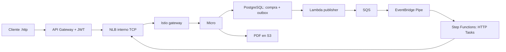

# Ruta NLB activa: sincronizar WSL y practicar

Estado al 2026-11-05: **ya desplegado y probado en LocalStack de laptop**.
No hace falta recrear laboratorio. Paquete sincroniza fuentes WSL para que un
redeploy futuro conserve HTTP/NLB y actualiza recibo local de despliegue.



Step Functions no llama API Gateway ni Lambda. Publisher y authorizer sí siguen
siendo Lambda. Recurso Lambda de transporte anterior se conserva para reversión,
pero workflow nuevo no lo usa ni tiene permiso `lambda:InvokeFunction`.

NLB actual: `micro-test-local-nlb.elb.localhost.localstack.cloud:4512`.
Puerto se descubre por `DescribeListeners`; no debe fijarse para nuevos labs.
Target: nodo Docker Ready, NodePort `31080` → Istio → micro. No se añadió NAT,
proxy, ALB ni puerto público. No se reinició LocalStack.

## 1. Sincronizar fuentes en laptop

Copia `nlb-http-fix.zip` a Windows y extráelo en `C:\mnt\nlb-http-fix`.
Comprueba que `apply.py` quede directamente en esa carpeta. Desde **WSL**:

```bash
python3 /mnt/c/mnt/nlb-http-fix/apply.py \
  --repo /mnt/c/Users/josue/source/repos/micro-test-local-lab --apply &&
cd /mnt/c/Users/josue/source/repos/micro-test-local-lab &&
export PATH="$PWD/localstack/.state/tools:$HOME/.local/bin:$PATH"
```

Aplicador acepta versiones conocidas de paquetes anteriores y preserva cambios
no reconocidos: valida todos los archivos antes de copiar. Repetir es idempotente.
No copia tokens, kubeconfig, datos, reportes ni archivos `.state`.

## 2. Comprobar y sincronizar recibo de despliegue

Desde misma raíz **WSL**, con venv existente:

```bash
localstack/.venv/bin/python localstack/scaling/flow.py deploy-network \
  --endpoint http://127.0.0.1:4566 &&
localstack/.venv/bin/python localstack/scaling/http_cutover.py \
  --endpoint http://127.0.0.1:4566
```

En estado actual red debe indicar `unchanged`. Cutover verifica propiedad,
plantilla equivalente al código y salud real; sincroniza recibo local si cambio
fue desplegado desde Mac. Pausa Pipe, deja terminar workflows y restaura estado
anterior después de verificar HTTP Tasks. Mensajes nuevos permanecen en SQS.
No acepta cambios desconocidos en CloudFormation. Guarda `before.json` y
`after.json` en reporte. Si falla actualización, Pipe queda detenido para revisión.
`CONFIGURED` significa configuración verificada, no nueva compra de aceptación.

Para comprobar salud sin cambiar configuración/targets:

```bash
localstack/.venv/bin/python localstack/scaling/flow.py probe \
  --endpoint http://127.0.0.1:4566
```

`UNREACHABLE_FROM_CLIENT` puede aparecer para llamada desde host al puerto NLB;
resultado decisivo es ejecución HTTP desde runtime: `status: PASS`, HTTP 200/UP.

## 3. Enviar compra desde .http

URL pública del API no cambió. `Accept`, `Poll` y `Retry` del `.http` existente
siguen funcionando con JWT vigente. Publisher periódico puede agregar espera.
No necesitas ExecutionArn para buscar `saleId` en Aspire.

Si JWT expiró, guarda primero modificaciones propias: comando siguiente regenera
`localstack/.state/business/purchase.http` con token de una hora y referencias nuevas.
En **Mac** (endpoint accesible al editor):

```bash
localstack/.venv/bin/python localstack/business/business.py http \
  --endpoint http://100.100.154.68:4566
```

En WSL puedes generar archivo usando `--endpoint http://127.0.0.1:4566` para editor
que ejecute requests allí. Si editor está en Windows/Mac, usa endpoint Tailscale
`http://100.100.154.68:4566` accesible desde ese cliente.

1. Ejecuta `Accept`, copia `saleId` y consulta `Poll` hasta `COMPLETED`.
2. Abre PDF del resultado. Comprueba contenido y objeto S3.
3. En [Aspire en Mac](http://127.0.0.1:18888/traces), busca `saleId`; intentos nuevos
   aparecen bajo `http-nlb`. Trazas previas mantienen `lambda-transport`.
4. Usa bloques `Transient`, `Permanent` y `Retry` con referencias nuevas.
   Observa intentos fallidos, recuperación y mismo resultado lógico sin duplicados.

Visor reconstruye historial SFN: no es traza nativa HTTP/SQL ni cubre todavía
request de aceptación antes del workflow. Ver [observabilidad](../observability/README.md).

Para repetir suite completa desde **WSL** (crea compras de prueba e inyecta fallos):

```bash
localstack/.venv/bin/python localstack/business/business.py test \
  --endpoint http://127.0.0.1:4566
```

No ejecutar suite simultáneamente con tus ejercicios: prueba pausa/reanuda
publisher e introduce fallos controlados. Suite ya pasó desde Mac contra laptop;
reportes listados en [VALIDATION.md](VALIDATION.md).

## Límites y próximos ejercicios

- HPA CPU + RAM preparado, instalación/carga/reducción pendientes WSL.
  Karpenter y prueba de nodo real pendientes. Comandos en [README](README.md).
- Target NLB se registra puntualmente; no hay controlador reconciliando nodos.
  Antes de cambiar targets, pausa Pipe, drena workflows y detén envíos API.
  Script restaura targets anteriores si falla prueba nativa de salud.
- HTTP y red Docker sustituyen únicamente conectividad local. No prueban Lattice,
  VPC Link, TLS de entrada, enforcement IAM, costos ni latencia AWS.
- Connection usa credencial ficticia del lab; endpoints internos no adquieren
  identidad de servicio productiva por tener un NLB delante.
- HTTP Tasks tienen timeout 20 s; workflow 240 s, menor a lease 300 s.
  Parser LocalStack instalado rechaza `States.Http.Socket` en Retry; configuración
  local reintenta `States.Timeout`, 408/429 y 500/502/503/504.
- Persistencia LocalStack continúa deshabilitada. No se validó recuperación tras
  reiniciar emulador; ninguna prueba requiere reiniciarlo.

[Prueba consolidada](../reports/laptop/20261105T172511Z-5aefa3/nlb-http-acceptance.json):
compra normal ejecutó 7 HTTP Tasks y 0 eventos Lambda; PDF verificado.
