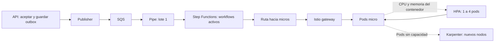

# Pipes, HPA y Karpenter: laboratorio laptop

Destino exclusivo: `localstack-laptop`, Mac `http://100.100.154.68:4566`,
WSL `http://127.0.0.1:4566`. Scripts usan credenciales ficticias `test/test`,
verifican identidad LocalStack y no heredan credenciales AWS del equipo.
No reinician LocalStack. Persistencia continúa deshabilitada.

## Decisión de flujo

Se mantiene **outbox → publisher → SQS → EventBridge Pipes → Step Functions Standard**.
No hay EventBridge Event Bus en ese tramo. Pipe consume SQS y solicita el inicio
del workflow; no espera que termine. Por eso cola vacía no significa micros libres.

Configuración aplicada el 2026-11-05:

| Control | Valor / significado |
|---|---|
| `BatchSize` | `1`: contrato de una compra por ejecución |
| `MaximumBatchingWindowInSeconds` | `0`: sin espera adicional de agrupación |
| Target `InvocationType` | `FIRE_AND_FORGET`, requerido para Standard |
| Pipe | `RUNNING`; pausa manual disponible |
| SQS visibility | 60 s; controla reentrega durante admisión, no duración del workflow |
| SQS redrive | DLQ tras 3 recepciones fallidas; no recibe automáticamente workflows que fallaron después del inicio |
| Retención SQS | 4 días |

**Pipes/SQS no ofrece `maxExecutionsPerSecond` ni `MaximumConcurrency` configurable
como el event source mapping SQS de Lambda.** Ventana de lote no es intervalo entre
arranques; con lote de 1 se puede entregar al llenarse inmediatamente. No aumentar
BatchSize: el consumidor actual no acepta varias compras por ejecución.
No usar cuotas/throttling de Step Functions como regulador de negocio.
[Parámetros SQS](https://docs.aws.amazon.com/eventbridge/latest/pipes-reference/API_PipeSourceSqsQueueParameters.html),
[target Step Functions](https://docs.aws.amazon.com/eventbridge/latest/userguide/eb-pipes-event-target.html).

Pausar Pipe deja acumular mensajes; no cancela workflows ni detiene publisher.
Reanudar puede producir ráfaga. No agregamos filtros: mensajes descartados por
filtro no constituyen una cola de espera. Si después se exige tasa global estricta,
habrá que revisar admisión; no está implementada por mantener Pipes.

## Escalado: qué controla cada componente



Ruta de compras activa: **HTTP Task → NLB TCP → NodePort → Istio → micro**.
Aceptación autenticada también pasa por ese NLB. Compra/PDF y recuperación
validados; ver [ruta desplegada y sincronización WSL](NLB_HTTP.md).
Karpenter empieza con un workload separado en el mismo EKS, no con el micro.

HPA `autoscaling/v2`: CPU del contenedor `micro`, objetivo 60%, memoria media 512Mi,
mínimo 1, máximo 4,
subida máxima 1 pod/60 s, reducción 1 pod/60 s con estabilización de 300 s.
Con request actual 100m, objetivo por pod equivale a 60m. No incluye CPU del
sidecar. Memoria usa `AverageValue`, no porcentaje del request. Request actual
384Mi y límite 768Mi permanecen iguales: 512Mi es umbral inicial de laboratorio,
no resultado de medición ni garantía contra OOM. El instalador permite cambiarlo
con `--memory-target-mib`, exige que quede debajo del límite observado y comprueba
muestras de CPU **y** memoria antes de aplicar.

HPA calcula réplicas para cada métrica y elige el máximo: CPU **o** RAM pueden
pedir más pods. Para reducir, ambas recomendaciones deben permitirlo; errores al
leer una métrica pueden impedir reducción. Solo se mide `micro`, no sidecar Istio.
Es configuración de práctica para laptop, no dimensionamiento productivo.
[ContainerResource](https://kubernetes.io/docs/concepts/workloads/autoscaling/horizontal-pod-autoscale/#container-resource-metrics).

Buenas prácticas para calibrar RAM:

- Medir memoria en reposo después de warm-up, bajo carga y después de retirar carga.
  Si memoria base supera umbral, nuevas réplicas también lo superarán: escalar no
  resolverá el problema y HPA puede quedarse en máximo.
- En Java, memoria de contenedor no equivale a heap usado. Contar heap, metaspace,
  buffers, threads y agente OpenTelemetry; dejar margen al límite del contenedor.
  GC/heap retenido puede retrasar reducción. No fijamos `Xmx` sin mediciones.
- Inspeccionar reinicios/OOMKilled y latencia; HPA no evita un pico individual de
  memoria ni corrige fugas. Concurrencia en curso puede resultar mejor señal de
  escalado si memoria no baja al repartir trabajo.
- `minReplicas: 1` prioriza costo del lab. Producción requiere decidir redundancia,
  distribución entre nodos/AZ, disponibilidad y capacidad inicial según SLO.

```bash
kubectl --kubeconfig localstack/.state/kubeconfig -n micro-test-local-general top pods --containers
kubectl --kubeconfig localstack/.state/kubeconfig -n micro-test-local-general describe hpa micro-test-local-micro
```

HPA reacciona a métricas; no predice llegadas. Karpenter reacciona a pods pendientes;
no recibe mensajes de EventBridge. Para planificar capacidad, medir CPU-segundos
por compra en cada deployment y usar aproximación de estado estable:

`réplicas ≈ ceil(compras/s × CPU-segundos/compra ÷ (CPU request × objetivo HPA))`.

No sustituye prueba de carga: ignora ráfagas, DB, esperas, memoria y reintentos.
Workflows activos ≈ tasa × duración media solo bajo condiciones estables.
Medir también p95/p99 de aceptación, duración de workflow, HTTP 429/5xx, pods
Pending y tiempo desde NodeClaim hasta Ready. Mantener capacidad caliente para
aceptación; ni HPA ni Karpenter garantizan respuesta inmediata a ráfagas.

```bash
# Mac, desde raíz del repo. Estimación ilustrativa, CPU-segundos NO medidos.
localstack/.venv/bin/python localstack/scaling/flow.py estimate \
  --rate 5 --cpu-seconds 0.2 --cpu-request 0.1 --target 0.6 --max 4
localstack/.venv/bin/python localstack/scaling/flow.py observe
```

Ejemplo exige 17 réplicas y marca que supera límite 4. No oculta saturación.
`observe` muestra cola aproximada, arranques de últimos 60 s y workflows RUNNING;
no garantiza snapshot atómico ni informa pico de cualquier ventana de 1 segundo.
En AWS, complementar con CloudWatch SQS AgeOfOldestMessage, métricas Pipes de
fallos/throttling e indicadores de aplicación. Concurrency de Pipe no equivale
a workflows Standard activos. No se creó dashboard CloudWatch en este cambio.
[Métricas Pipes](https://docs.aws.amazon.com/eventbridge/latest/userguide/eb-pipes-monitoring.html).

## Ejecutar desde WSL

Para paquete nuevo `nlb-http-fix.zip`, sigue primero [NLB_HTTP.md](NLB_HTTP.md).
Los comandos siguientes corresponden al paquete original de escalado.

Si recibiste ZIP, extráelo en **Windows `C:\mnt\scaling-lab`**, separado del repo.
Aplicador comprueba hashes y conserva cambios existentes; solo añade archivos de
`localstack/scaling`. Mensaje final genérico del aplicador menciona RUNBOOK anterior:
para este paquete sigue los pasos siguientes.

```bash
python3 /mnt/c/mnt/scaling-lab/apply.py \
  --repo /mnt/c/Users/josue/source/repos/micro-test-local-lab --apply

cd /mnt/c/Users/josue/source/repos/micro-test-local-lab
export PATH="$PWD/localstack/.state/tools:$HOME/.local/bin:$PATH"

localstack/.venv/bin/python localstack/scaling/runtime.py inspect \
  --network k3d-micro-test-local-50dacdf7
```

1. **HPA CPU + RAM**, pendiente de ejecución en WSL. Aplicar ZIP solo copia código: este comando
   es el que instala/actualiza HPA. Comprueba muestras reales de metrics-server
   antes de aplicar. Si faltan, falla sin declarar HPA operativo.

```bash
localstack/.venv/bin/python localstack/scaling/runtime.py hpa \
  --network k3d-micro-test-local-50dacdf7 --memory-target-mib 512

kubectl --kubeconfig localstack/.state/kubeconfig \
  -n micro-test-local-general get hpa,pods -w
```

En otra terminal WSL, carga acotada por API autenticada. Genera compras de prueba
y PDFs; no purga datos ni invoca publisher manualmente. Un pico breve puede no
causar escalado: eso no demuestra un error del HPA.

```bash
localstack/.venv/bin/python localstack/scaling/exercise.py \
  --endpoint http://127.0.0.1:4566 --count 20 --rate 2
```

Revisar HPA `ScalingActive`, CPU, RAM, réplicas actuales/deseadas y pods Pending.
Observar reducción después de estabilización. No escalar manualmente deployment
mientras HPA lo controla: reconciliará el cambio. Para practicar manualmente,
eliminar únicamente este HPA y después reaplicarlo con comando anterior:

```bash
kubectl --kubeconfig localstack/.state/kubeconfig -n micro-test-local-general \
  delete hpa micro-test-local-micro
kubectl --kubeconfig localstack/.state/kubeconfig -n micro-test-local-general \
  scale deployment/micro-test-local-micro --replicas=2
```

2. **NLB e Istio**. Ruta de negocio ya activa y validada. Comprueba sin cambiar
   targets; `probe` ejecuta HTTP Task de salud contra listener TCP observado:

```bash
localstack/.venv/bin/python localstack/scaling/flow.py probe \
  --endpoint http://127.0.0.1:4566
```

Listener observado usa `4512`; `4566` corresponde a APIs LocalStack. Código descubre
puerto mediante `DescribeListeners`. Target actual es IP Docker de nodo Ready,
NodePort `31080`, y llega al gateway Istio. No es registro directo de IP de pod AWS.
No se publicó un puerto nuevo ni se expuso NLB a Internet. Mac puede no alcanzar
4512 aunque HTTP Task dentro del emulador sí lo alcance.

No ejecutes `runtime.py nlb --targets pods` como comprobación: modifica targets.
Para experimentar con targets, pausa Pipe, espera workflows activos y detén envíos
API. Script exige Pipe detenido y cero workflows si cambia targets de negocio;
restaura targets anteriores si falla salud. No impide nuevas requests API.
Registro es puntual; no hay AWS Load Balancer Controller reconciliando nodos.
Tras reemplazo de nodo hay que actualizar targets y volver a validar compra/PDF.
Detalles y limitaciones: [NLB_HTTP.md](NLB_HTTP.md).

3. **Karpenter AWS 1.8.2**, mismo EKS. Instala Helm verificado en `.state/tools`
   si falta; descarga chart con checksum fijo. Egreso del controller permite solo
   LocalStack, Kubernetes y DNS. Antes de arrancarlo verifica que NetworkPolicy
   bloquea un puerto RDS previamente alcanzable y mantiene acceso a 4566.

```bash
localstack/.venv/bin/python localstack/scaling/runtime.py karpenter \
  --network k3d-micro-test-local-50dacdf7

localstack/.venv/bin/python localstack/scaling/runtime.py node-test \
  --network k3d-micro-test-local-50dacdf7
```

Descargas públicas de herramientas/imágenes requieren Internet; APIs AWS apuntan
exclusivamente a LocalStack. NodePool permite `t3.medium`, on-demand, límite CPU 2,
taint dedicado y `lab-role=karpenter-practice`. Expiración/consolidación desactivadas
al principio. Límite Karpenter no es cuota física estricta de Docker ni garantiza
máximo de nodos ante reconciliaciones concurrentes; prueba crea una sola réplica.

Éxito exige: NodeClaim Ready → nodo con providerID de instancia local etiquetada
→ pod nginx Ready → respuesta HTTP real desde ese pod. Controller Ready o EC2
`running` por sí solos no bastan. Si falla, informe conserva NodeClaims, pods y
logs recientes. No sustituye nodos por KWOK ni crea cluster alternativo.

Micro sigue en nodos general administrados. Para llevarlo a Karpenter después de
prueba, falta preparar imagen accesible en workers nuevos (hoy `imagePullPolicy:
Never`), etiquetas/taints, conectividad SQL/S3 y prueba PDF. No importar imagen
solo en nodos existentes y dar por aprobado autoscaling.

```bash
kubectl --kubeconfig localstack/.state/kubeconfig get nodepools,nodeclaims,nodes
kubectl --kubeconfig localstack/.state/kubeconfig \
  -n micro-test-local-karpenter logs deployment/karpenter --tail=100
```

Después de validar nodo real, practicar consolidación **solo del pool de prueba**:

```bash
kubectl --kubeconfig localstack/.state/kubeconfig -n micro-test-local-karpenter \
  scale deployment/micro-test-local-practice --replicas=0
kubectl --kubeconfig localstack/.state/kubeconfig patch nodepool micro-test-local-practice \
  --type=merge -p '{"spec":{"disruption":{"consolidationPolicy":"WhenEmpty","consolidateAfter":"60s","budgets":[{"nodes":"1"}]}}}'
kubectl --kubeconfig localstack/.state/kubeconfig get nodeclaims,nodes -w
```

Confirmar eliminación de instancia/contenedor además del objeto Kubernetes.
No ejecutar prueba sobre nodos administrados general/onprem/terceros. Reejecutar
`karpenter` restaura política inicial sin consolidación. No se probaron drenaje ni
reducción de nodos desde Mac.

## Ejercicio de acumulación

```bash
# WSL. No ejecutar durante una prueba que espere completar compras inmediatamente.
localstack/.venv/bin/python localstack/scaling/flow.py pipe-pause --endpoint http://127.0.0.1:4566
# Enviar 3 compras con purchase.http; esperar publicación periódica.
localstack/.venv/bin/python localstack/scaling/flow.py observe --endpoint http://127.0.0.1:4566
localstack/.venv/bin/python localstack/scaling/flow.py pipe-resume --endpoint http://127.0.0.1:4566
localstack/.venv/bin/python localstack/scaling/flow.py observe --endpoint http://127.0.0.1:4566
```

Comparar cola, workflows activos, CPU y réplicas. Al terminar, comprobar estado de
cada compra y PDF; cola cero o HTTP 202 no certifican finalización.

## Evidencia y límites actuales

Ver [VALIDATION.md](VALIDATION.md). No reiniciar emulador para arreglar soporte:
persistencia deshabilitada pone en riesgo estado del laboratorio.
Opciones de conectividad y límites de emulación: [NETWORK_OPTIONS.md](NETWORK_OPTIONS.md).

[Soporte Karpenter documentado por LocalStack](https://docs.localstack.cloud/aws/services/eks/#self-managed-nodes-and-karpenter),
[chart Karpenter 1.8.2](https://github.com/aws/karpenter-provider-aws/tree/v1.8.2/charts/karpenter).
Documentación anuncia workers reales; instalación concreta aún exige prueba WSL.
